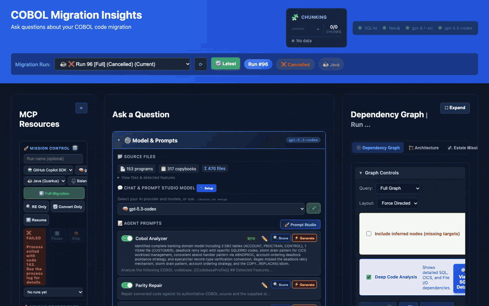
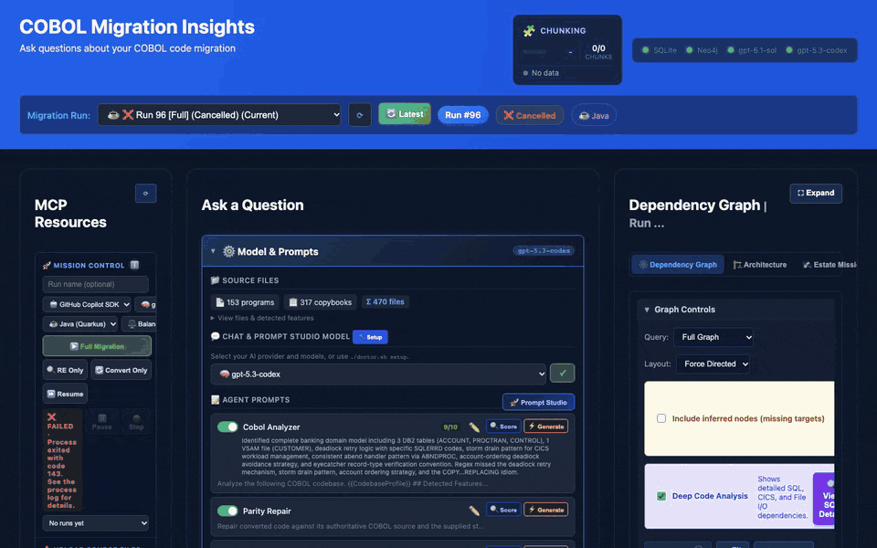
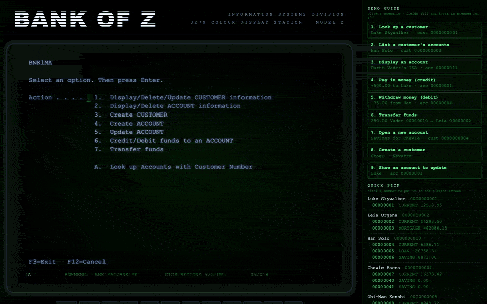
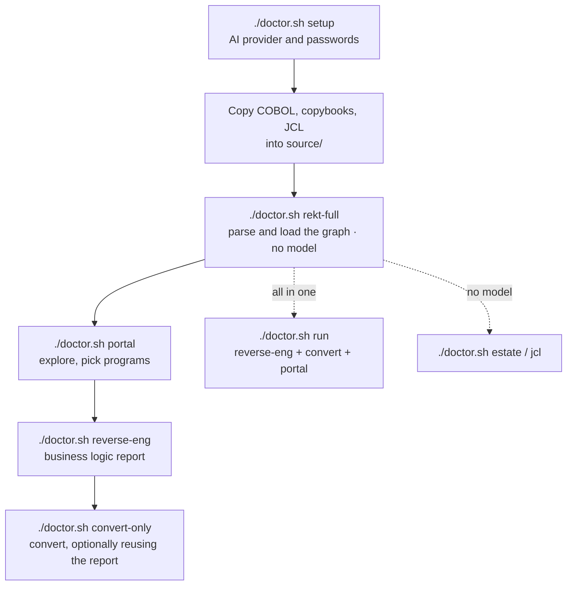
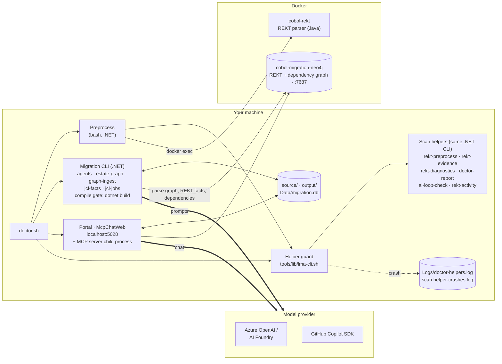
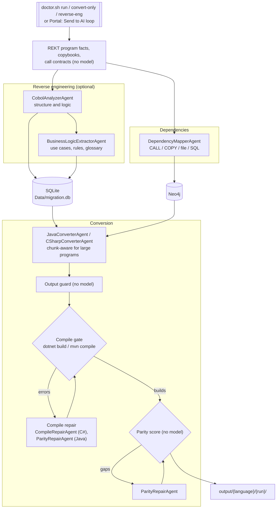

# Legacy Modernization Agents - COBOL to Java/C# Migration

This open source migration framework was developed to demonstrate AI Agents capabilities for converting legacy code like COBOL to Java or C# .NET. Each Agent has a persona that can be edited depending on the desired outcome.
The migration uses Microsoft Agent Framework with a multi-provider architecture supporting **Azure OpenAI** (Responses API + Chat Completions), **GitHub Copilot** (PAT or CLI-based SDK), and **direct OpenAI** to analyze COBOL code and its dependencies, then convert to either Java Quarkus or C# .NET (user's choice).

## Portal demo

The portal (`./doctor.sh portal`, http://localhost:5028) shows your estate, what the agents did, and what the parser saw. The recordings use the public Bank-of-Z sample; all demos with full descriptions are in [Portal demo](docs/portal.md#portal-demo).



*Estate Mission Control: every program, CICS transaction, API, DB2 table and data store in the estate, built deterministically from source with no model calls.*



*AST Explorer: the parsed structure of each COBOL program beside its source.*

> [!NOTE]
> - **Structure view:** expand a section and click a paragraph. The source jumps to it, and the Inspector shows its statement mix (MOVE, IF, PERFORM and so on).
> - **Raw AST view:** the parser's own nodes. Hover a node for its type, name and parser ID. Click a statement to see the exact COBOL the parser captured, or a paragraph to open its source range.
> - **Why it matters:** check for parse gaps before you convert. A statement missing from the AST was not parsed, so structure-based evidence (call graphs, readiness checks, structural context) cannot account for it. The conversion prompt still carries the source text, so a gap is a verification risk rather than proof the model never saw the line.
>
> See [AST Explorer](docs/portal.md#ast-explorer).



*The Bank-of-Z COBOL/CICS programs converted to Java Spring Boot and running, mapped 1:1 so each COBOL step can be traced to its Java equivalent.*

---

## Table of Contents
- [Quick Start](#quick-start)
  - [Step by step](#step-by-step)
- [doctor.sh commands](#doctorsh-commands)
- [How it fits together](#how-it-fits-together)
  - [What runs where](#what-runs-where)
  - [Agent flowchart](#agent-flowchart)
  - [Docker containers](#docker-containers)
- [Portal](#portal)
- [Configuration](#configuration)
- [Troubleshooting](#troubleshooting)
- [Documentation](#documentation)
- [Workflows](#workflows)
- [License](#license)

---

## Quick Start

### Prerequisites

| Requirement | Version | Notes |
|-------------|---------|-------|
| **.NET SDK** | 10.0+ | [Download](https://dotnet.microsoft.com/download) |
| **Docker Desktop** | Latest | Must be running for Neo4j |
| **AI Endpoint** | — | Azure endpoint + `az login`, or GitHub Copilot `copilot login`, or API Key |

On Windows, `doctor.sh` runs in Git Bash or WSL2; see [Windows](docs/getting-started.md#windows).

### Step by step

```mermaid
flowchart LR
    A["./doctor.sh setup<br/>Azure OpenAI or GitHub Copilot"] --> B["Copy COBOL, copybooks,<br/>BMS, JCL into source/"]
    B --> C["./doctor.sh rekt-full<br/>parse + load graph<br/><i>no model</i>"]
    C --> D["./doctor.sh portal<br/>explore the code"]
    D --> E["Pick programs<br/>Estate Mission Control /<br/>Convert Programs"]
    E --> R["./doctor.sh reverse-eng<br/>business logic report"]
    R --> F["Optional: edit<br/>Agents/Prompts/*.md"]
    F --> G["./doctor.sh convert-only<br/>or ./doctor.sh run"]
    G --> H["output/csharp or output/java<br/>review in the AI Loop"]
```



Run every command from the repository root. **Always use `./doctor.sh`, not `dotnet run`**: it checks prerequisites and starts the containers each step needs.

#### 1. Configure the AI endpoint

```bash
git clone https://github.com/Azure-Samples/Legacy-Modernization-Agents.git
cd Legacy-Modernization-Agents
./doctor.sh setup
```

> [!NOTE]
> **GitHub Copilot: `copilot login` is part of setup.** Install the Copilot CLI first (`npm install -g @github/copilot`). When setup asks how to authenticate, choose **1) Copilot CLI sign-in**; it runs `copilot login` and you finish the sign-in in the browser. Setup then lists only the models your Copilot plan allows. If the sign-in fails or you cancel it, run `copilot login` yourself and run `./doctor.sh setup` again. See [Copilot sign-in](docs/getting-started.md#copilot-sign-in).

The wizard asks for the provider, credentials, models and the Neo4j password, and writes them to `Config/ai-config.local.env` (git-ignored):

| Provider | Choose in setup | Then sign in |
|---|---|---|
| **Azure OpenAI / Azure AI Foundry** | Endpoint and deployment names; Entra ID (recommended) or an API key | `az login` |
| **GitHub Copilot (GHCP)** | GitHub Copilot SDK; the wizard lists the models your licence can use | `copilot login`, or a fine-grained token with **Copilot Requests** in `COPILOT_GITHUB_TOKEN` |

> [!IMPORTANT]
> **Sign in before you run anything that calls a model.** The framework takes its token from your local sign-in; it does not prompt for one.
>
> - **Azure (Entra ID):** add `--tenant <id>` to `az login` if the resource is in another tenant. Your account needs the **Cognitive Services OpenAI User** role on the resource. See [az login authentication](docs/az-login-auth-guide.md).
> - **GitHub Copilot:** use the Copilot CLI's `copilot login`, not `gh`. Classic `ghp_` tokens do not work, and the account needs a Copilot licence. `./doctor.sh setup` records the choice as `COPILOT_AUTH`. See [Copilot sign-in](docs/getting-started.md#copilot-sign-in).
>
> Without a valid sign-in (or an API key in `Config/ai-config.local.env`), conversion and reverse engineering fail on the first model call. `rekt-full`, `estate` and `jcl` call no model and need no sign-in.

#### 2. Copy your COBOL into `source/`

> [!IMPORTANT]
> **The clone does not contain your estate. Copy your files into `source/` before scanning**, and again whenever they change: COBOL programs (`.cbl`), copybooks (`.cpy`), BMS maps (`.bms`), CICS definitions and JCL jobs (`.jcl`) with their procedures and INCLUDE members (`.proc`, `.prc`, `.inc`). Subfolders are fine; each top-level folder of `source/` is treated as its own estate. Set `JCL_SOURCE_FOLDER` for an external JCL library.

```bash
cp -r /path/to/your/cobol/* source/
```

#### 3. Scan the source with REKT

```bash
./doctor.sh rekt-full                 # parse every program, then load the graph into Neo4j
./doctor.sh rekt-full --parallel 4    # parse 4 programs at once (large estates)
```

`rekt-full` calls no model and needs no sign-in. It parses COBOL with the REKT parser in the `cobol-rekt` container, extracts JCL facts, records each program's parse fidelity, lists copybooks that are referenced but missing (`output/rekt/missing-copybooks.txt`), and loads everything into Neo4j. Each program prints one progress line with stage times and an estimate of the time left.

| Option | Effect |
|---|---|
| `--parallel N` (or `REKT_PARSE_JOBS=N`) | Parse 1–16 programs at once. 2–4 is a good choice; allow about 1 GB of Docker memory per job. Results are identical to a sequential scan |
| `./doctor.sh rekt-parse` / `rekt-ingest` | Run only the parse half or only the Neo4j load |
| `./doctor.sh rekt-status` | Container, graph and export status |
| `REKT_VERBOSE=true` | Also stream the parser's own output (normally kept in `output/rekt/**/*.parse.log`) |
| `REKT_NO_BMS_MAPS=true` | Do not generate symbolic map copybooks from BMS mapsets |

Unchanged programs are skipped as `(cached)`, so a rerun after a small change takes minutes. Add any missing copybooks to `source/` and run `rekt-full` again before converting. See [Parse first: rekt-full](docs/doctor-commands.md#parse-first-rekt-full).

#### 4. Explore the code in the portal

```bash
./doctor.sh portal                    # http://localhost:5028
```

**🛰 Estate Mission Control** maps every program, transaction, table and data store; **AST Explorer** shows what the parser saw for each program; **Convert Programs** lists programs by parse fidelity with their call closure. See [Portal](docs/portal.md).

#### 5. Pick the programs to convert

- **Estate Mission Control → ✂️ Carve-out plan**: click a cluster and press **📦 Stage slice**. The panel lists the programs, what they call and what is missing from `source/`, and gives the exact command. **🔁 Send to AI loop** starts the conversion from the portal instead.
- **Convert Programs**: tick programs and copy the generated `convert-only` command.
- **Terminal**: `./doctor.sh estate` prints the wave plan; `./doctor.sh estate C01` prints one cluster and its command.

#### 6. Reverse engineer the business logic

```bash
./doctor.sh reverse-eng                              # every program in source/
./doctor.sh reverse-eng --program ORDMAIN.cbl,ORDDATE.cbl   # only the selected programs
```

**This is the step that explains the estate.** `CobolAnalyzerAgent` and `BusinessLogicExtractorAgent` read each program and write `output/reverse-engineering-details.md`: the business purpose, use cases, business rules and a glossary, with technical details per program. Nothing is converted. The results are also saved to `Data/migration.db`, so you can:

- read them in the portal (each run card has **🔬 RE Results**) and ask questions with **Ask the Report**;
- reuse them in a later conversion: `./doctor.sh convert-only` asks whether to load the saved results from the last reverse-engineering run over the same source folder (answer **Y**).

Reusing them is off by default, because converters given only a summary tend to skip paragraphs; the COBOL source and the REKT facts always take precedence over the report. See [Reverse engineering reports](docs/REVERSE_ENGINEERING_ARCHITECTURE.md#reverse-engineering-reports) and [Business logic persistence](docs/doctor-commands.md#business-logic-persistence-and---reuse-re).

#### 7. Optional: tune the agent prompts

Each agent's instructions are a Markdown file in `Agents/Prompts/`. Edit them to change the output, for example to add Domain-Driven Design patterns or a naming convention, or use **Prompt Studio** in the portal to generate, AI-enhance and score them.

| Agent | Prompt file |
|---|---|
| COBOL analysis | `CobolAnalyzer.md` |
| Business logic (reverse engineering) | `BusinessLogicExtractor.md` |
| Java / C# conversion | `JavaConverter.md` / `CSharpConverter.md` |
| Large programs (chunked) | `ChunkAwareJavaConverter.md` / `ChunkAwareCSharpConverter.md` |
| Dependency mapping | `DependencyMapper.md` |

Keep the `## SECTION:` headings and placeholders such as `{{CodebaseProfile}}`; they are filled in at run time. See [Customizing agent behavior](docs/customizing-agent-prompts.md).

#### 8. Convert

```bash
# The whole estate in source/
./doctor.sh run --language CSharp                          # reverse engineering + conversion + portal
./doctor.sh convert-only --language Java                   # conversion only

# Selected programs
./doctor.sh convert-only --language Java --program ORDMAIN.cbl --dry-run    # preview the selection, no model call
./doctor.sh convert-only --language Java --program ORDMAIN.cbl,ORDDATE.cbl
./doctor.sh convert-only --language CSharp --program orders/cbl/ORDMAIN.cbl --include-callees --clean-output

# A JCL job and every program it runs
./doctor.sh run --job NITEJ001 --language CSharp
```

| Option | Effect |
|---|---|
| `--language CSharp` / `Java` | Target language; `--java-framework Spring` or `Quarkus` for Java |
| `--program A.cbl,B.cbl` | Convert only these programs (repeat or comma-separate; use the path under `source/` when two programs share a name) |
| `--include-callees` | Also convert every program the selection calls, directly or indirectly. The call closure comes from the REKT scan, so it follows every CALL branch through the estate; the portal must be running |
| `--job NAME` | Convert the programs a JCL job runs and generate the job; their callees are added when the portal is running |
| `--dry-run` | Show what would be converted without calling a model |
| `--clean-output` | Write into an empty output folder |

Copybooks are always carried in by the programs that COPY them. Output goes to `output/<language>/<run>/` with `compile-status.json`, `conversion-parity.json` and a migration report; the **🔁 AI Loop** tab shows each model call, retry and quality gate. See [Working with generated output](docs/using-generated-output.md) and the [doctor.sh command reference](docs/doctor-commands.md).

[Getting started](docs/getting-started.md) covers Windows, Copilot sign-in details, manual setup without the wizard, the folder layout and what a run generates.

---

## doctor.sh commands

Which command to run first:



| Command | What it does | Calls a model? |
|---|---|---|
| `./doctor.sh` | Health check: verifies prerequisites and configuration | No |
| `./doctor.sh setup` | Interactive setup wizard: AI provider, credentials, models and local services | No (only lists models) |
| `./doctor.sh rekt-full` | Parses COBOL with REKT, extracts JCL facts and loads both into Neo4j. Run before converting | No |
| `./doctor.sh portal` | Launches the web portal only (http://localhost:5028) | Only for chat |
| `./doctor.sh estate [C01]` | Slices and migration waves from the source alone; with a cluster ID, its `convert-only` command | No |
| `./doctor.sh jcl` | Jobs from the JCL alone: what each job still needs | No |
| **`./doctor.sh reverse-eng`** | **Reverse engineering**: business purpose, use cases, rules and glossary per program in `output/reverse-engineering-details.md`, saved to the database for the portal and for reuse in conversion; launches the portal. Accepts `--program` | Yes |
| `./doctor.sh convert-only` | Conversion only (`--program`, `--job`, `--include-callees`, `--dry-run`, `--java-framework Spring`) | Yes |
| `./doctor.sh run` | Full migration: reverse engineering → convert → launch portal | Yes |

See [doctor.sh command reference](docs/doctor-commands.md) for every option: interactive prompts, speed profiles, parallel parsing, several estates in one `source/`, JCL, partial conversion and `--reuse-re`.

---

## How it fits together

### What runs where



- **Everything but the model runs locally.** Source code leaves the machine only inside the prompts sent to the provider you configured.
- **One Neo4j instance** (`:7687`) holds both the REKT graph (parse trees and control flow) and the migration graph (dependencies found during a run). Every node is keyed by its run, so runs and scans sit side by side without overwriting each other. The port and container name can be changed in `Config/ai-config.local.env`.
- **The portal runs on the host** (`dotnet run --project McpChatWeb`). `docker-compose.yml` also has a `portal` service if you want it in a container.
- **Estate Mission Control and `jcl`** need neither a model nor Docker.
- **No Python.** The prerequisites are the .NET SDK, Docker and Bash. Every helper `doctor.sh` and `tools/*.sh` call is a command of the same .NET CLI.

### Agent flowchart

Seven agents call the model; everything between them is deterministic code. A conversion moves through the chart top to bottom:



1. **Facts first.** The selected programs' REKT parse results, copybooks and call signatures are collected without a model. They become the ground truth every agent receives.
2. **Reverse engineering** (`run` and `reverse-eng`): **CobolAnalyzerAgent** describes each program's structure and logic, and **BusinessLogicExtractorAgent** turns that into use cases, business rules and a glossary. Both are stored in SQLite; `--reuse-re` reuses them in later runs.
3. **Dependencies:** **DependencyMapperAgent** records CALL, COPY, file and SQL relationships in Neo4j.
4. **Conversion:** the **Java or C# converter agent** writes the target code, splitting large programs into chunks. The **output guard** rejects empty, truncated or placeholder answers before anything is written.
5. **Compile gate:** the output is built (`dotnet build` or `mvn compile`). Compiler errors go to a repair agent file by file, for at most `CompileGate.MaxRepairRounds` rounds; a round that makes things worse is undone.
6. **Parity:** a deterministic check compares procedures, fields, calls and SQL in the output with the COBOL. **ParityRepairAgent** fills the gaps it finds, and a fix is kept only if the re-measured score improves.
7. **Report:** results land in `output/<language>/<run>/` (`compile-status.json`, `conversion-parity.json`, migration report), and the **🔁 AI Loop** tab shows every call, retry and gate.

See [Architecture](docs/architecture.md) for agent inputs and outputs, storage and data flow.

### Docker containers

`docker-compose.yml` defines three services. `doctor.sh` starts the ones a command needs; you rarely run `docker compose` yourself.

| Service (default container name) | Image | Job | Started by | Ports | Data |
|---|---|---|---|---|---|
| `neo4j` (`cobol-migration-neo4j`) | `neo4j:5.15.0` with APOC and Graph Data Science | The single graph database. Holds the REKT graph (parse trees, control flow, data layout, JCL facts) written by `graph-ingest`, and the dependency graph (CALL, COPY, file and SQL edges) written during a conversion. The portal's graph tabs, the AST Explorer and the conversion's REKT context read from it. | `setup` (pull), `rekt-full`, `run`, `convert-only`, `reverse-eng` | `127.0.0.1:7474` (browser), `127.0.0.1:7687` (Bolt) | Volumes `graph_data`, `graph_logs`, `graph_import` |
| `cobol-rekt` (`cobol-rekt`) | `rekt-oss-mma`, built locally from `tools/cobol-rekt/` | The COBOL parser: a patched build of [cobol-rekt](https://github.com/avishek-sen-gupta/cobol-rekt) (Java 21). It idles and `doctor.sh` runs the parser in it with `docker exec`, one JVM per program, producing AST, control-flow and data JSON. It makes no model calls and has no network port. | `rekt-full` / `rekt-parse`, only when COBOL is present | None | Reads `source/` (read-only); writes `output/rekt/` |
| `portal` (`cobol-migration-portal`) | Built from the root `Dockerfile` (.NET 10 CLI + `McpChatWeb`) | Optional containerized portal. By default the portal runs on the host instead (`./doctor.sh portal`); use this service only to run it in Docker. | `docker compose up -d portal` | `5028` | Mounts `Data/`, `Logs/` and `Config/` |

- **The model is never in a container.** Prompts go from the host CLI (or the portal) to the configured provider.
- **Passwords and names** come from `Config/ai-config.local.env`: `NEO4J_PASSWORD` is required, and container names and host ports can be overridden (`NEO4J_CONTAINER`, `NEO4J_HTTP_PORT`, `NEO4J_BOLT_PORT`, `REKT_CONTAINER`, `MCP_WEB_PORT`) to run two checkouts side by side.
- **Rebuilds:** `doctor.sh` tags the parser image with a digest of its Dockerfile and patches, so changing either rebuilds it automatically.
- **Status:** `./doctor.sh rekt-status` shows container, graph and export status; `docker compose ps` lists them.
- **Dev container:** `.devcontainer/` is a separate VS Code development environment (.NET 10, Node, Azure CLI, GitHub CLI, Docker-in-Docker) that runs the services above inside it. See [.devcontainer/README.md](.devcontainer/README.md).

How `rekt-full` and a conversion work inside, storage and the agents: see [Architecture](docs/architecture.md).

---

## Portal

`./doctor.sh portal` (or the end of `./doctor.sh run`) opens the portal at http://localhost:5028. Its tabs show the dependency graph, the REKT architecture, Estate Mission Control, the AI Loop, modernization intelligence, the AST Explorer, Convert Programs, the Program Explorer and missing copybooks. The tabs that read parse results need `./doctor.sh rekt-full` first.

- [Portal](docs/portal.md) - every tab, the AST Explorer, Convert Programs and the demo recordings
- [Estate Mission Control and the AI Loop](docs/estate-mission-control.md) - clusters, carve scores, waves and per-run model activity
- [Ask the Report](docs/ask-the-report.md) - chat answers from a reverse-engineering report
- [Dependency Health & Semantic Flow Explorer](docs/dependency-health-and-flow-explorer.md) - parse fidelity, topology and JCL chains

---

## Configuration

| File | Purpose | Git Tracked? |
|------|---------|--------------|
| `Config/appsettings.json` | **All settings** - models, chunking, Neo4j, output paths | Yes |
| `Config/ai-config.env.example` | Copy source for your local config | Yes |
| `Config/ai-config.local.env` | **Your secrets** - API keys, endpoints | No (gitignored) |

> **Estate data stays local.** Source, output, logs and estate-specific rules are git-ignored, and a pre-commit guard blocks estate names. Run `tools/check-no-estate-data.sh --install-hook` once per clone. See [Keeping estate data private](docs/keeping-estate-data-private.md).

Values load in the order `appsettings.json` → `ai-config.local.env` → environment variables; later values override earlier ones. See [Configuration reference](docs/configuration.md) for key settings, Neo4j and sizing parallel jobs to your model quota.

---

## Troubleshooting

```bash
./doctor.sh               # Check configuration
./doctor.sh test          # Run system tests
./doctor.sh chunking-health  # Check chunking setup
```

| Issue | Solution |
|-------|----------|
| Neo4j connection refused | Load `NEO4J_PASSWORD` from `Config/ai-config.local.env`, then run `docker-compose up -d neo4j` |
| Azure API error | Check `Config/ai-config.local.env` credentials or run `az login` |
| No output generated | Ensure COBOL files are in `source/` |
| Portal won't start | `lsof -ti :5028 \| xargs kill -9` then retry |
| A scan or command reports *Internal helper crashed* | A .NET helper threw an unhandled exception. The stack trace is in `Logs/doctor-helpers.log` and, for scans, in `helper-crashes.log` beside `scan.json`. Run `./doctor.sh` to check prerequisites, then rerun |
| Build fails with `MSB3923 Failed to download file … registry.npmjs.org`, or setup says *Could not fetch user-specific models* | The network blocks the npm registry the Copilot SDK downloads its CLI from. `doctor.sh` falls back to your npm mirror or your installed Copilot CLI automatically; for plain `dotnet` commands, see [Building behind an NPM registry block](docs/building-behind-an-npm-registry-block.md) |
| `rekt-full` stops with *Source identity collisions prevent safe REKT staging* | REKT reads copybooks by name from one folder, so it stops only when two copybooks share a name, differ, and a `COPY` or `INCLUDE` uses that name. The message lists the copies and the files that use them. Rename one copy, or move the estate you are not parsing out of `source/`. Copies with the same text, or that nothing uses, are staged and reported as a note |

---

## Documentation

| Document | Contents |
|---|---|
| [Getting started](docs/getting-started.md) | Prerequisites, Windows, AI providers and Copilot sign-in, manual setup, folder layout and generated files |
| [doctor.sh command reference](docs/doctor-commands.md) | Every `doctor.sh` command and option, `rekt-full`, JCL, partial and draft conversion, speed profile |
| [Configuration reference](docs/configuration.md) | Configuration loading, key settings, Azure OpenAI, Neo4j, quota and the parallel jobs formula |
| [Architecture](docs/architecture.md) | Inside `rekt-full` and a conversion, hybrid SQLite/Neo4j storage, agent pipeline and responsibilities, data flow |
| [Portal](docs/portal.md) | Portal tabs, Estate Mission Control screenshots, AST Explorer, Convert Programs, demo recordings |
| [Customizing agent behavior](docs/customizing-agent-prompts.md) | Prompt templates per agent, DDD example, service-oriented Spring output |
| [File splitting and naming](docs/file-splitting-and-naming.md) | Split strategies, naming conversion, Spring and source-isolated partial conversion |
| [Estate Mission Control and the AI Loop](docs/estate-mission-control.md) | Deterministic clusters, carve scores and waves for converting the estate slice by slice, and a per-run view of model calls, retries, fallbacks and quality gates |
| [Dependency Health & Semantic Flow Explorer](docs/dependency-health-and-flow-explorer.md) | Deterministic parse-fidelity, topology and JCL chain surfaces for deciding conversion order; strict versus draft dependency eligibility |
| [Ask the Report](docs/ask-the-report.md) | Portal chat answering from a reverse-engineering report, and saved chats |
| [Reverse Engineering Process Architecture](docs/REVERSE_ENGINEERING_ARCHITECTURE.md) | Reverse engineering reports, sample output, glossary, process flow and database schema |
| [Legacy Modernization Flow](docs/legacy-modernization-flow.md) | How a run moves from COBOL through reverse engineering to generated code |
| [Smart Chunking & Token Strategy Architecture](docs/smart-chunking-architecture.md) | Automatic chunking, full diagrams, constants reference and complexity scoring |
| [Smart Chunking: Deep Technical Documentation](docs/smart-chunking-deep-dive.md) | Chunking pipeline, consistency mechanisms and database schema in depth |
| [Ordered chunk output assembly](docs/chunked-output-assembly.md) | How chunk-aware converters' continuation fragments are assembled and accepted |
| [Speed Profiles](docs/speed-profiles.md) | TURBO/FAST/BALANCED/THOROUGH env var overrides and complexity scoring |
| [Conversion Parity Validation](docs/conversion-parity-validation.md) | Deterministic check that generated code represents the COBOL it came from, with per-axis coverage and a configurable threshold |
| [Working with generated output](docs/using-generated-output.md) | Run folders, compile gate and what generated code needs before it builds and runs |
| [Source decoding and generated output ownership](docs/source-reading-and-output-ownership.md) | Source encoding policy and per-target-path ownership of generated files |
| [JCL job facts](docs/jcl-job-facts.md) | Deterministic JCL parser: procedures, symbols, conditions, Db2 runs and dataset lineage across jobs |
| [Jobs generated from JCL](docs/jcl-jobs.md) | Each JCL job as a .NET job (C#) or Spring Batch job (Java) that runs the converted programs under the JCL's conditions |
| [Bundled system copybooks](docs/bundled-system-copybooks.md) | SQLCA/SQLDA parser inputs supplied when the source has none, with provenance |
| [Explicit platform replacement contracts](docs/platform-replacement-contracts.md) | Replacing a platform service explicitly, without redistributing its SDK copybooks |
| [Bank-of-Z source corrections](docs/bank-of-z-source-corrections.md) | Corrections applied to the Bank-of-Z demonstration estate |
| [Keeping estate data private](docs/keeping-estate-data-private.md) | Git ignores, the pre-commit guard and local estate rules |
| [Azure AD / Entra ID Authentication Guide](docs/az-login-auth-guide.md) | Keyless auth setup |
| [Building behind an NPM registry block](docs/building-behind-an-npm-registry-block.md) | Restoring the Copilot CLI download on a network that blocks the public registry |
| [Validation and portal integration plan](docs/validation-and-portal-integration-plan.md) | Proposed plan for integrating validation and portal work (not yet executed) |
| [Spec-Driven Code Generation](docs/spec-approach-concept.md) | A considered approach, deferred and not implemented; kept for the reasoning rather than as a description of the tool |
| [Dev container](.devcontainer/README.md) | The VS Code development container |
| [Changelog](CHANGELOG.md) | Version history |

---

## Workflows

| Workflow / Agent | Trigger | Description |
|---|---|---|
| [Documentation Updater](.github/workflows/documentation-updater.lock.yml) | Push to `main` | Checks documentation completeness and reports gaps via issues or PR comments |
| [Documentation Audit](.github/workflows/documentation-audit.lock.yml) | Weekly schedule | Performs a full audit of project documentation for accuracy and completeness |
| [Test Enhancer](.github/workflows/test-enhancer.lock.yml) | On demand | Agentic workflow that analyzes the codebase and proposes improvements to test coverage |
| [Branch Reviewer](.github/agents/pr-review.agent.md) | On demand (Copilot CLI) | Reviews branch changes, summarizes commits, and detects breaking changes vs. `main` |
| [Cross-platform checks](.github/workflows/cross-platform.yml) | Pull requests touching scripts or code, push to `main`, on demand | Runs on Ubuntu and on Windows under Git Bash: shell scripts must parse and use LF endings; exercises `doctor.sh` platform helpers, JCL discovery, REKT preprocessing scripts and portal process control |

---

## Acknowledgements

Collaboration between Microsoft's Global Black Belt team and [Bankdata](https://www.bankdata.dk/). See [blog post](https://aka.ms/cobol-blog).

## License

MIT License - Copyright (c) Microsoft Corporation. See [LICENSE](LICENSE).
