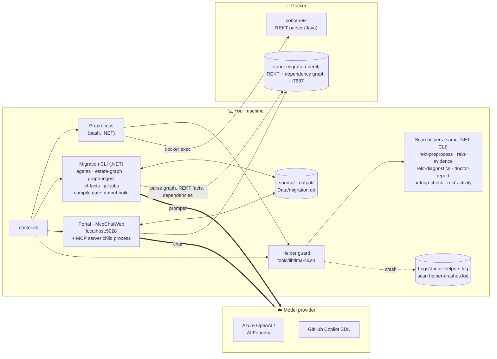

# Legacy Modernization Agents - COBOL to Java/C# Migration

This open source migration framework was developed to demonstrate AI Agents capabilities for converting legacy code like COBOL to Java or C# .NET. Each Agent has a persona that can be edited depending on the desired outcome.
The migration uses Microsoft Agent Framework with a multi-provider architecture supporting **Azure OpenAI** (Responses API + Chat Completions), **GitHub Copilot** (PAT or CLI-based SDK), and **direct OpenAI** to analyze COBOL code and its dependencies, then convert to either Java Quarkus or C# .NET (user's choice).

## 🎬 Portal demo

The portal (`./doctor.sh portal`, http://localhost:5028) shows your estate, what the agents did, and what the parser saw. Both recordings use the public Bank-of-Z sample; all demos with full descriptions are in [Portal demo](docs/portal.md#portal-demo).


*Estate Mission Control: every program, CICS transaction, API, DB2 table and data store in the estate, built deterministically from source with no model calls.*


*The Bank-of-Z COBOL/CICS programs converted to Java Spring Boot and running, mapped 1:1 so each COBOL step can be traced to its Java equivalent.*

---

## 📋 Table of Contents
- [Quick Start](#-quick-start)
- [doctor.sh commands](#-doctorsh-commands)
- [How it fits together](#-how-it-fits-together)
  - [What runs where](#what-runs-where)
  - [Docker containers](#docker-containers)
- [Portal](#-portal)
- [Configuration](#-configuration)
- [Troubleshooting](#-troubleshooting)
- [Documentation](#-documentation)
- [Workflows](#-workflows)

---

## 🚀 Quick Start

### Prerequisites

| Requirement | Version | Notes |
|-------------|---------|-------|
| **.NET SDK** | 10.0+ | [Download](https://dotnet.microsoft.com/download) |
| **Docker Desktop** | Latest | Must be running for Neo4j |
| **AI Endpoint** | — | Azure endpoint + `az login`, or GitHub Copilot `copilot login`, or API Key |

On Windows, `doctor.sh` runs in Git Bash or WSL2; see [Windows](docs/getting-started.md#windows).

### Setup

```bash
git clone https://github.com/Azure-Samples/Legacy-Modernization-Agents.git
cd Legacy-Modernization-Agents

./doctor.sh setup        # 1. configure the AI provider and credentials
cp -r /path/to/your/cobol/* source/   # 2. COBOL, copybooks and JCL
az login                 #    or: copilot login (GitHub Copilot SDK)
./doctor.sh rekt-full    # 3. parse COBOL + JCL (no model) - run before converting
./doctor.sh run          # 4. migrate, then open the portal
```

> [!IMPORTANT]
> **The clone does not contain your estate. Add your source files to `source/` before scanning.**
> Copy COBOL, copybooks, JCL jobs and their procedures/INCLUDE members into that folder
> (subfolders are supported), or set `JCL_SOURCE_FOLDER` for an external JCL library.
> `bash ./doctor.sh rekt-full` discovers COBOL, JCL, or both and loads the graph;
> it does **not** generate executable jobs. `bash ./doctor.sh jcl` is the separate
> job-scaffolding command. See [JCL discovery and facts](docs/jcl-job-facts.md).

> [!IMPORTANT]
> **Sign in before you run anything that calls a model.** The framework takes its token from your local sign-in; it does not prompt for one.
>
> | Provider | Sign in with | Then |
> |---|---|---|
> | Azure OpenAI / Azure AI Foundry (Entra ID) | `az login` (add `--tenant <id>` if the resource is in another tenant) | Your account needs the **Cognitive Services OpenAI User** role on the resource. See [az login authentication](docs/az-login-auth-guide.md) |
> | GitHub Copilot SDK | `copilot login` (the Copilot CLI, not `gh`), or a fine-grained token with the **Copilot Requests** permission in `COPILOT_GITHUB_TOKEN` | `./doctor.sh setup` asks which and records it as `COPILOT_AUTH`. Classic `ghp_` tokens do not work. The account needs a Copilot licence. See [Copilot sign-in](docs/getting-started.md#copilot-sign-in) |
>
> Without a valid sign-in (or an API key in `Config/ai-config.local.env`), conversion and reverse engineering fail on the first model call. `./doctor.sh rekt-full`, `./doctor.sh estate` and `./doctor.sh jcl` call no model and need no sign-in.

### First run

Run these in order from the repository root:

| Step | Command | What it does |
|---|---|---|
| 1 | *(copy files)* | **Put your sources in `source/`**: COBOL programs (`.cbl`), copybooks (`.cpy`), BMS maps (`.bms`), CICS definitions, and JCL jobs (`.jcl`) with their procedures and INCLUDE members (`.proc`, `.prc`, `.inc`). Subfolders are fine |
| 2 | `./doctor.sh setup` | **Configure the framework**: AI provider, credentials, models and local services |
| 3 | `./doctor.sh rekt-full` | **Discover and scan COBOL, JCL, or both**: parses COBOL with REKT, extracts JCL facts into `output/rekt/`, and ingests both into Neo4j. JCL-only input is supported; no executable jobs or model calls. See [Parse first: rekt-full](docs/doctor-commands.md#parse-first-rekt-full) |
| 4 | `./doctor.sh portal` | **Open the portal** at http://localhost:5028 |
| 5 | *(portal)* | **Pick what to migrate in 🛰 Estate Mission Control**: switch to **✂️ Carve-out plan**, click a cluster, and press **📦 Stage slice**. The panel lists the programs, what they call, and what is missing from `source/`, and gives the exact command to run. **🔁 Send to AI loop** starts the conversion from the portal instead. See [Estate Mission Control](docs/portal.md#estate-mission-control) |
| 6 | *(the suggested command)* | **Convert the slice**, for example `./doctor.sh convert-only --program ORDER01.cbl,ORDER02.cbl` |

Estate Mission Control builds from `source/` alone. The portal's chat and report pages need at least one run (`./doctor.sh reverse-eng`, `convert-only` or `run`).

**Always use `./doctor.sh run` to run migrations, not `dotnet run` directly.** The doctor script checks dependencies and starts the services it needs.

[Getting started](docs/getting-started.md) covers supported AI providers, Copilot sign-in, manual setup without the wizard, the folder layout and what a run generates.

---

## 🎯 doctor.sh commands

| Command | What it does | Calls a model? |
|---|---|---|
| `./doctor.sh` | Health check: verifies prerequisites and configuration | No |
| `./doctor.sh setup` | Interactive setup wizard: AI provider, credentials, models and local services | No (only lists models) |
| `./doctor.sh rekt-full` | Parses COBOL with REKT, extracts JCL facts and loads both into Neo4j. Run before converting | No |
| `./doctor.sh portal` | Launches the web portal only (http://localhost:5028) | Only for chat |
| `./doctor.sh estate [C01]` | Slices and migration waves from the source alone; with a cluster ID, its `convert-only` command | No |
| `./doctor.sh jcl` | Jobs from the JCL alone: what each job still needs | No |
| `./doctor.sh reverse-eng` | Extracts business logic, persists it to the database, launches the portal | Yes |
| `./doctor.sh convert-only` | Conversion only (`--program`, `--job`, `--include-callees`, `--dry-run`, `--java-framework Spring`) | Yes |
| `./doctor.sh run` | Full migration: analyze → convert → launch portal | Yes |

See [doctor.sh command reference](docs/doctor-commands.md) for every option: interactive prompts, speed profiles, parallel parsing, several estates in one `source/`, JCL, partial conversion and `--reuse-re`.

---

## 🗺 How it fits together

### What runs where



- **Everything but the model runs locally.** Source code leaves the machine only inside the prompts sent to the provider you configured.
- **One Neo4j instance** (`:7687`) holds both the REKT graph (parse trees and control flow) and the migration graph (dependencies found during a run). Every node is keyed by its run, so runs and scans sit side by side without overwriting each other. The port and container name can be changed in `Config/ai-config.local.env`.
- **The portal runs on the host** (`dotnet run --project McpChatWeb`). `docker-compose.yml` also has a `portal` service if you want it in a container.
- **Estate Mission Control and `jcl`** need neither a model nor Docker.
- **No Python.** The prerequisites are the .NET SDK, Docker and Bash. Every helper `doctor.sh` and `tools/*.sh` call is a command of the same .NET CLI.

### Docker containers

`docker-compose.yml` defines three services. `doctor.sh` starts the ones a command needs; you rarely run `docker compose` yourself.

| Service (default container name) | Image | Job | Started by | Ports | Data |
|---|---|---|---|---|---|
| `neo4j` (`cobol-migration-neo4j`) | `neo4j:5.15.0` with APOC and Graph Data Science | The single graph database. Holds the REKT graph (parse trees, control flow, data layout, JCL facts) written by `graph-ingest`, and the dependency graph (CALL, COPY, file and SQL edges) written during a conversion. The portal's graph tabs, the AST Explorer and the conversion's REKT context read from it. | `setup` (pull), `rekt-full`, `run`, `convert-only`, `reverse-eng` | `127.0.0.1:7474` (browser), `127.0.0.1:7687` (Bolt) | Volumes `graph_data`, `graph_logs`, `graph_import` |
| `cobol-rekt` (`cobol-rekt`) | `rekt-oss-mma`, built locally from `tools/cobol-rekt/` | The COBOL parser: a patched build of [cobol-rekt](https://github.com/avishek-sen-gupta/cobol-rekt) (Java 21). It idles and `doctor.sh` runs the parser in it with `docker exec`, one JVM per program, producing AST, control-flow and data JSON. It makes no model calls and has no network port. | `rekt-full` / `rekt-parse`, only when COBOL is present | None | Reads `source/` (read-only); writes `output/rekt/` |
| `portal` (`cobol-migration-portal`) | Built from the root `Dockerfile` (.NET 10 CLI + `McpChatWeb`) | Optional containerized portal. By default the portal runs on the host instead (`./doctor.sh portal`); use this service only to run it in Docker. | `docker compose up -d portal` | `5028` | Mounts `Data/`, `Logs/` and `Config/` |

- **The model is never in a container.** Prompts go from the host CLI (or the portal) to the configured provider.
- **Passwords and names** come from `Config/ai-config.local.env`: `NEO4J_PASSWORD` is required, and container names and host ports can be overridden (`NEO4J_CONTAINER`, `NEO4J_HTTP_PORT`, `NEO4J_BOLT_PORT`, `REKT_CONTAINER`, `MCP_WEB_PORT`) to run two checkouts side by side.
- **Rebuilds:** `doctor.sh` tags the parser image with a digest of its Dockerfile and patches, so changing either rebuilds it automatically.
- **Status:** `./doctor.sh rekt-status` shows container, graph and export status; `docker compose ps` lists them.
- **Dev container:** `.devcontainer/` is a separate VS Code development environment (.NET 10, Node, Azure CLI, GitHub CLI, Docker-in-Docker) that runs the services above inside it. See [.devcontainer/README.md](.devcontainer/README.md).

How `rekt-full` and a conversion work inside, storage and the agents: see [Architecture](docs/architecture.md).

---

## 🖥 Portal

`./doctor.sh portal` (or the end of `./doctor.sh run`) opens the portal at http://localhost:5028. Its tabs show the dependency graph, the REKT architecture, Estate Mission Control, the AI Loop, modernization intelligence, the AST Explorer, Convert Programs, the Program Explorer and missing copybooks. The tabs that read parse results need `./doctor.sh rekt-full` first.

- [Portal](docs/portal.md) - every tab, the AST Explorer, Convert Programs and the demo recordings
- [Estate Mission Control and the AI Loop](docs/estate-mission-control.md) - clusters, carve scores, waves and per-run model activity
- [Ask the Report](docs/ask-the-report.md) - chat answers from a reverse-engineering report
- [Dependency Health & Semantic Flow Explorer](docs/dependency-health-and-flow-explorer.md) - parse fidelity, topology and JCL chains

---

## 🔧 Configuration

| File | Purpose | Git Tracked? |
|------|---------|--------------|
| `Config/appsettings.json` | **All settings** - models, chunking, Neo4j, output paths | ✅ Yes |
| `Config/ai-config.env.example` | Copy source for your local config | ✅ Yes |
| `Config/ai-config.local.env` | **Your secrets** - API keys, endpoints | ❌ No (gitignored) |

> **Estate data stays local.** Source, output, logs and estate-specific rules are git-ignored, and a pre-commit guard blocks estate names. Run `tools/check-no-estate-data.sh --install-hook` once per clone. See [Keeping estate data private](docs/keeping-estate-data-private.md).

Values load in the order `appsettings.json` → `ai-config.local.env` → environment variables; later values override earlier ones. See [Configuration reference](docs/configuration.md) for key settings, Neo4j and sizing parallel jobs to your model quota.

---

## 🆘 Troubleshooting

```bash
./doctor.sh               # Check configuration
./doctor.sh test          # Run system tests
./doctor.sh chunking-health  # Check chunking setup
```

| Issue | Solution |
|-------|----------|
| Neo4j connection refused | Load `NEO4J_PASSWORD` from `Config/ai-config.local.env`, then run `docker-compose up -d neo4j` |
| Azure API error | Check `Config/ai-config.local.env` credentials or run `az login` |
| No output generated | Ensure COBOL files are in `source/` |
| Portal won't start | `lsof -ti :5028 \| xargs kill -9` then retry |
| A scan or command reports *Internal helper crashed* | A .NET helper threw an unhandled exception. The stack trace is in `Logs/doctor-helpers.log` and, for scans, in `helper-crashes.log` beside `scan.json`. Run `./doctor.sh` to check prerequisites, then rerun |
| Build fails with `MSB3923 Failed to download file … registry.npmjs.org`, or setup says *Could not fetch user-specific models* | The network blocks the npm registry the Copilot SDK downloads its CLI from. `doctor.sh` falls back to your npm mirror or your installed Copilot CLI automatically; for plain `dotnet` commands, see [Building behind an NPM registry block](docs/building-behind-an-npm-registry-block.md) |
| `rekt-full` stops with *Source identity collisions prevent safe REKT staging* | REKT reads copybooks by name from one folder, so it stops only when two copybooks share a name, differ, and a `COPY` or `INCLUDE` uses that name. The message lists the copies and the files that use them. Rename one copy, or move the estate you are not parsing out of `source/`. Copies with the same text, or that nothing uses, are staged and reported as a note |

---

## 📚 Documentation

| Document | Contents |
|---|---|
| [Getting started](docs/getting-started.md) | Prerequisites, Windows, AI providers and Copilot sign-in, manual setup, folder layout and generated files |
| [doctor.sh command reference](docs/doctor-commands.md) | Every `doctor.sh` command and option, `rekt-full`, JCL, partial and draft conversion, speed profile |
| [Configuration reference](docs/configuration.md) | Configuration loading, key settings, Azure OpenAI, Neo4j, quota and the parallel jobs formula |
| [Architecture](docs/architecture.md) | Inside `rekt-full` and a conversion, hybrid SQLite/Neo4j storage, agent pipeline and responsibilities, data flow |
| [Portal](docs/portal.md) | Portal tabs, Estate Mission Control screenshots, AST Explorer, Convert Programs, demo recordings |
| [Customizing agent behavior](docs/customizing-agent-prompts.md) | Prompt templates per agent, DDD example, service-oriented Spring output |
| [File splitting and naming](docs/file-splitting-and-naming.md) | Split strategies, naming conversion, Spring and source-isolated partial conversion |
| [Estate Mission Control and the AI Loop](docs/estate-mission-control.md) | Deterministic clusters, carve scores and waves for converting the estate slice by slice, and a per-run view of model calls, retries, fallbacks and quality gates |
| [Dependency Health & Semantic Flow Explorer](docs/dependency-health-and-flow-explorer.md) | Deterministic parse-fidelity, topology and JCL chain surfaces for deciding conversion order; strict versus draft dependency eligibility |
| [Ask the Report](docs/ask-the-report.md) | Portal chat answering from a reverse-engineering report, and saved chats |
| [Reverse Engineering Process Architecture](docs/REVERSE_ENGINEERING_ARCHITECTURE.md) | Reverse engineering reports, sample output, glossary, process flow and database schema |
| [Legacy Modernization Flow](docs/legacy-modernization-flow.md) | How a run moves from COBOL through reverse engineering to generated code |
| [Smart Chunking & Token Strategy Architecture](docs/smart-chunking-architecture.md) | Automatic chunking, full diagrams, constants reference and complexity scoring |
| [Smart Chunking: Deep Technical Documentation](docs/smart-chunking-deep-dive.md) | Chunking pipeline, consistency mechanisms and database schema in depth |
| [Ordered chunk output assembly](docs/chunked-output-assembly.md) | How chunk-aware converters' continuation fragments are assembled and accepted |
| [Speed Profiles](docs/speed-profiles.md) | TURBO/FAST/BALANCED/THOROUGH env var overrides and complexity scoring |
| [Conversion Parity Validation](docs/conversion-parity-validation.md) | Deterministic check that generated code represents the COBOL it came from, with per-axis coverage and a configurable threshold |
| [Working with generated output](docs/using-generated-output.md) | Run folders, compile gate and what generated code needs before it builds and runs |
| [Source decoding and generated output ownership](docs/source-reading-and-output-ownership.md) | Source encoding policy and per-target-path ownership of generated files |
| [JCL job facts](docs/jcl-job-facts.md) | Deterministic JCL parser: procedures, symbols, conditions, Db2 runs and dataset lineage across jobs |
| [Jobs generated from JCL](docs/jcl-jobs.md) | Each JCL job as a .NET job (C#) or Spring Batch job (Java) that runs the converted programs under the JCL's conditions |
| [Bundled system copybooks](docs/bundled-system-copybooks.md) | SQLCA/SQLDA parser inputs supplied when the source has none, with provenance |
| [Explicit platform replacement contracts](docs/platform-replacement-contracts.md) | Replacing a platform service explicitly, without redistributing its SDK copybooks |
| [Bank-of-Z source corrections](docs/bank-of-z-source-corrections.md) | Corrections applied to the Bank-of-Z demonstration estate |
| [Keeping estate data private](docs/keeping-estate-data-private.md) | Git ignores, the pre-commit guard and local estate rules |
| [Azure AD / Entra ID Authentication Guide](docs/az-login-auth-guide.md) | Keyless auth setup |
| [Building behind an NPM registry block](docs/building-behind-an-npm-registry-block.md) | Restoring the Copilot CLI download on a network that blocks the public registry |
| [Validation and portal integration plan](docs/validation-and-portal-integration-plan.md) | Proposed plan for integrating validation and portal work (not yet executed) |
| [Spec-Driven Code Generation](docs/spec-approach-concept.md) | A considered approach, deferred and not implemented; kept for the reasoning rather than as a description of the tool |
| [Dev container](.devcontainer/README.md) | The VS Code development container |
| [Changelog](CHANGELOG.md) | Version history |

---

## ⚙ Workflows

| Workflow / Agent | Trigger | Description |
|---|---|---|
| [Documentation Updater](.github/workflows/documentation-updater.lock.yml) | Push to `main` | Checks documentation completeness and reports gaps via issues or PR comments |
| [Documentation Audit](.github/workflows/documentation-audit.lock.yml) | Weekly schedule | Performs a full audit of project documentation for accuracy and completeness |
| [Test Enhancer](.github/workflows/test-enhancer.lock.yml) | On demand | Agentic workflow that analyzes the codebase and proposes improvements to test coverage |
| [Branch Reviewer](.github/agents/pr-review.agent.md) | On demand (Copilot CLI) | Reviews branch changes, summarizes commits, and detects breaking changes vs. `main` |
| [Cross-platform checks](.github/workflows/cross-platform.yml) | Pull requests touching scripts or code, push to `main`, on demand | Runs on Ubuntu and on Windows under Git Bash: shell scripts must parse and use LF endings; exercises `doctor.sh` platform helpers, JCL discovery, REKT preprocessing scripts and portal process control |

---

## Acknowledgements

Collaboration between Microsoft's Global Black Belt team and [Bankdata](https://www.bankdata.dk/). See [blog post](https://aka.ms/cobol-blog).

## License
