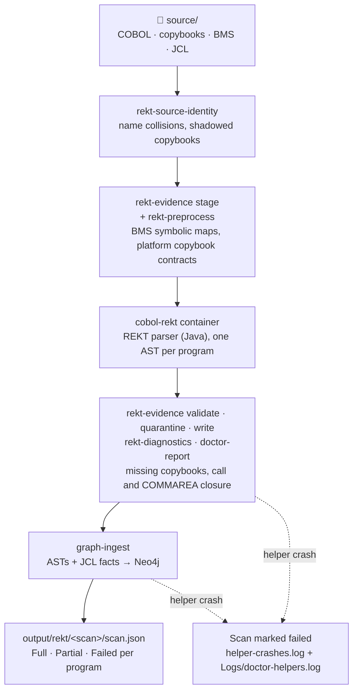
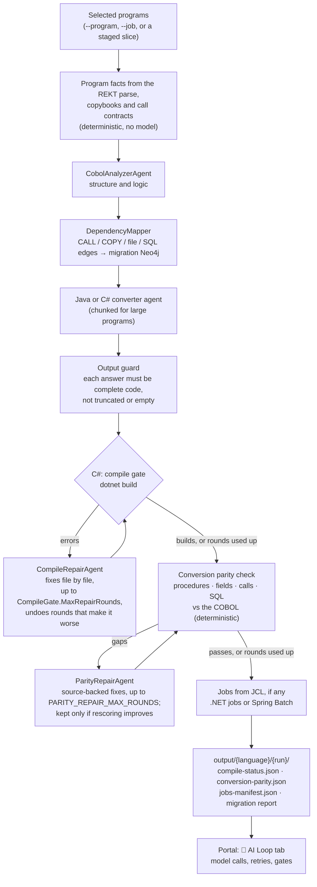
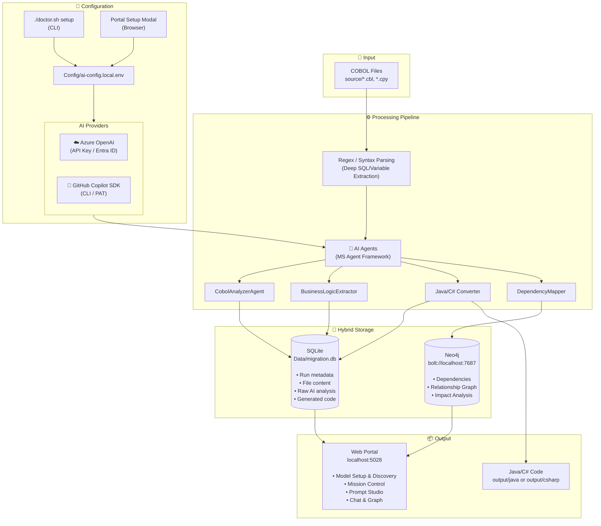
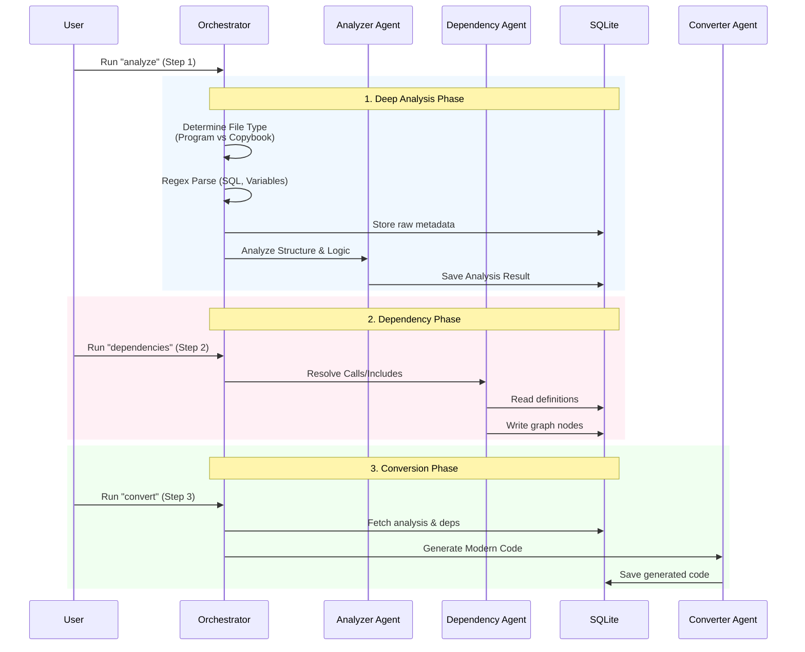
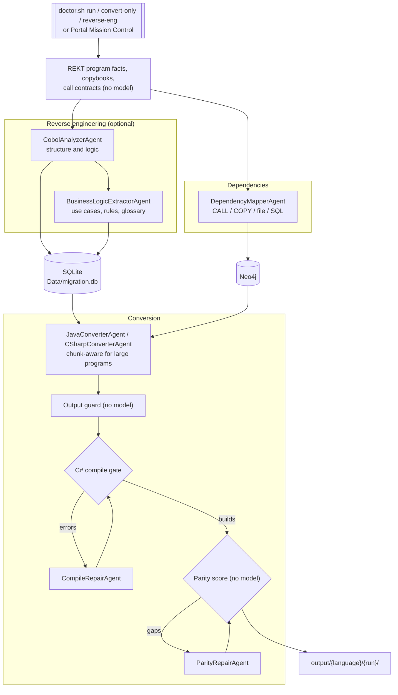
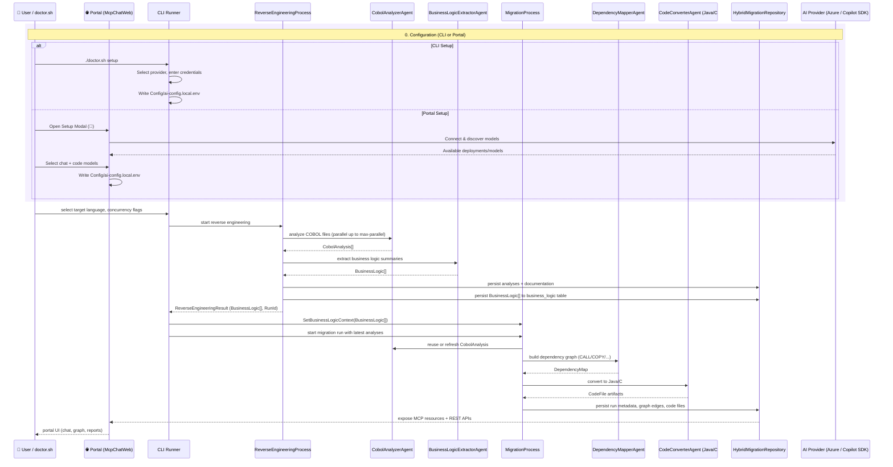

# Architecture

**Last updated**: 2026-11-18

> For the overview of what runs where and the Docker containers, see [How it fits together](../README.md#-how-it-fits-together) in the README. This page goes deeper into the scan, the conversion loop, storage, agents and concurrency.

## Inside `rekt-full`

Every helper runs through `lma_cli_run` in `tools/lib/lma-cli.sh`. A helper that crashes (an unhandled .NET exception or a runtime abort) fails the scan even when the calling step would have tolerated an ordinary non-zero exit, and its stack trace is kept in both logs. Run `./doctor.sh` to check prerequisites and rerun the scan. See [Estate Mission Control](estate-mission-control.md) for the scan record.

## Inside a conversion

Java output has no compile gate yet: build it with `mvn compile` in the output folder. The parity check can stop the run (`ON_LOW_SCORE=stop`); its score is always measured again from the files on disk after repairs. See [Conversion parity](conversion-parity-validation.md) and [Using the generated output](using-generated-output.md).

## Hybrid Database Architecture

This project uses a **dual-database approach** for optimal performance, enhanced with Regex-based deep analysis:

### Why Two Databases?

| Aspect | SQLite | Neo4j |
|--------|--------|-------|
| **Purpose** | Document storage | Relationship mapping |
| **Strength** | Fast queries, simple setup | Graph traversal, visualization |
| **Use Case** | "What's in this file?" | "What depends on this file?" |
| **Query Style** | SQL SELECT | Cypher graph queries |

**Together:** Fast metadata access + Powerful dependency insights 🚀

### Why Dependency Graphs Matter

The Neo4j dependency graph enables:
- **Impact Analysis** - "If I change CUSTOMER.cbl, what else breaks?"
- **Circular Dependency Detection** - Find problematic CALL/COPY cycles
- **Critical File Identification** - Most-connected files = highest risk
- **Migration Planning** - Convert files in dependency order
- **Visual Understanding** - See relationships at a glance in the portal

---

## Agent Pipeline

The migration follows a strict **Deep Code Analysis** pipeline:

## Smart Chunking & Token Strategy

Large COBOL files (>3,000 lines or >150K characters) are automatically split at semantic boundaries (DIVISION → SECTION → paragraph) and processed with content-aware reasoning effort. A three-tier complexity scoring system analyzes each file's COBOL patterns (EXEC SQL, CICS, REDEFINES, etc.) to dynamically allocate reasoning effort and output tokens — simple files get fast processing while complex files get thorough analysis.

The automatic chunking steps, the full token-strategy diagram, constants and complexity scoring weights are in [Smart Chunking & Token Strategy Architecture](smart-chunking-architecture.md).

## 🔄 Agent Flowchart

Seven agents call the model. Everything between them (parsing, chunking, the output guard, the compile gate and the parity score) is deterministic.

## 🔀 Agent Responsibilities & Interactions

### Advanced Sequence Flow (Mermaid)

### CobolAnalyzerAgent
- **Purpose:** Deep structural analysis of COBOL files (divisions, paragraphs, copybooks, metrics).
- **Inputs:** COBOL text from `FileHelper` or cached content.
- **Outputs:** `CobolAnalysis` objects consumed by:
  - `ReverseEngineeringProcess` (for documentation & glossary mapping)
  - `DependencyMapperAgent` (seed data for relationships)
  - `CodeConverterAgent` (guides translation prompts)
- **Interactions:**
  - Uses Azure OpenAI via `ResponsesApiClient` / `IChatClient` with concurrency guard.
  - Results persisted by `SqliteMigrationRepository`.

### BusinessLogicExtractorAgent
- **Purpose:** Convert technical analyses into business language (use cases, user stories, glossary).
- **Inputs:** Output from `CobolAnalyzerAgent` + optional glossary.
- **Outputs:** `BusinessLogic` records and Markdown sections used in `reverse-engineering-details.md`.
- **Interactions:**
  - Runs in parallel with analyzer results.
  - Writes documentation via `FileHelper` and logs via `EnhancedLogger`.
  - Results persisted to the `business_logic` SQLite table via `IMigrationRepository.SaveBusinessLogicAsync`, enabling reuse in subsequent `--skip-reverse-engineering --reuse-re` runs.

### DependencyMapperAgent
- **Purpose:** Identify CALL/COPY/PERFORM/IO relationships and build graph metadata.
- **Inputs:** COBOL files + analyses (line numbers, paragraphs).
- **Outputs:** `DependencyMap` with nodes/edges stored in both SQLite and Neo4j.
- **Interactions:**
  - Feeds the McpChatWeb graph panel and run-selector APIs.
  - Enables multi-run queries (e.g., "show me CALL tree for run 42").

### CodeConverterAgent(s)
- **Variants:** `JavaConverterAgent` or `CSharpConverterAgent` (selected via `TargetLanguage`).
- **Purpose:** Generate target-language code from COBOL analyses and dependency context.
- **Inputs:**
  - `CobolAnalysis` per file
  - Target language settings (Quarkus vs. .NET)
  - Migration run metadata (for logging & metrics)
  - `BusinessLogic` records per file (user stories, features, business rules) — injected only with `--reuse-re`: from the run's own RE in a full run, or loaded from the DB with `--skip-reverse-engineering`
- **Outputs:** `CodeFile` records saved under `output/java/` or `output/csharp/`.
- **Interactions:**
  - Concurrency guards (pipeline slots vs. AI calls) ensure Azure OpenAI limits respected.
  - Results pushed to portal via repositories for browsing/download.

### CompileRepairAgent
- **Purpose:** Fix C# compiler errors in generated files, one file at a time.
- **Inputs:** `dotnet build` diagnostics and the affected files.
- **Outputs:** Repaired files; a round that increases the error count is undone. Limited by `CompileGate.MaxRepairRounds`.

### ParityRepairAgent
- **Purpose:** Close gaps the deterministic parity check found between the COBOL and the generated code.
- **Inputs:** The COBOL source, the generated files, the measured gaps and read-only compiler context.
- **Outputs:** Replacement files, accepted only when rescoring shows higher coverage without loss on another axis. Limited by `PARITY_REPAIR_MAX_ROUNDS` (`0` measures only). See [Conversion parity](conversion-parity-validation.md#bounded-repair-and-final-measurement).

## ⚡ Concurrency Notes
- **Pipeline concurrency (`--max-parallel`)** controls how many files/chunks run simultaneously (e.g., 8).
- **AI concurrency (`--max-ai-parallel`)** caps concurrent Azure OpenAI calls (e.g., 3) to avoid throttling.
- Both values can be surfaced via CLI flags or environment variables to let `doctor.sh` tune runtime.

## 🔄 End-to-End Data Flow
1. `doctor.sh run` → load configs → choose target language
2. **Source scanning** - Reads all `.cbl`/`.cpy` files from `source/`
3. **Analysis** - `CobolAnalyzerAgent` extracts structure; `BusinessLogicExtractorAgent` generates documentation
4. **Dependencies** - `DependencyMapperAgent` maps CALL/COPY/PERFORM relationships → Neo4j
5. **Conversion** - `JavaConverterAgent` or `CSharpConverterAgent` generates target code → `output/`
6. **Storage** - `HybridMigrationRepository` writes metadata to SQLite, graph edges to Neo4j
7. **Portal** - `McpChatWeb` surfaces chat, graphs, and reports at http://localhost:5028

The portal UI is described in [Portal](portal.md).
