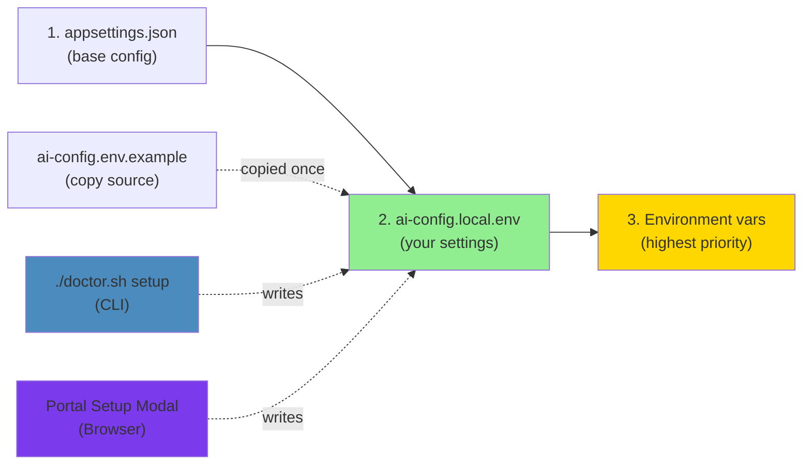

# Configuration reference

**Last updated**: 2026-11-18

How settings are loaded, where secrets and non-secret settings live, the required provider settings, Neo4j, and how to size parallelism to the model quota.

## Configuration Loading: .env vs appsettings.json

This project uses a **layered configuration system** where `.env` files can override `appsettings.json` values.

### Config Files Explained

| File | Purpose | Git Tracked? |
|------|---------|--------------|
| `Config/appsettings.json` | **All settings** - models, chunking, Neo4j, output paths | ✅ Yes |
| `Config/ai-config.env.example` | Copy source for your local config | ✅ Yes |
| `Config/ai-config.local.env` | **Your secrets** - API keys, endpoints | ❌ No (gitignored) |

> **Estate data stays local.** Source, output, logs and estate-specific rules are git-ignored, and a pre-commit guard blocks estate names. Run `tools/check-no-estate-data.sh --install-hook` once per clone. See [Keeping estate data private](keeping-estate-data-private.md).

### What Goes Where?

```
appsettings.json          → Non-secret settings (chunking, Neo4j, file paths)
ai-config.local.env       → Secrets (API keys, endpoints) - NEVER commit!
```

### Loading Order (Priority)

When you run `./doctor.sh run`, configuration loads in this order:



**Later values override earlier ones.** This means:
- `ai-config.local.env` overrides `appsettings.json`
- Environment variables override everything

`ai-config.env.example` is only ever copied to create your local config. It is not
loaded at runtime, so its placeholder values cannot stand in for a setting you left unset.

### How doctor.sh Loads Config

```bash
# Inside doctor.sh:
source "$REPO_ROOT/Config/load-config.sh"  # Loads the loader
load_ai_config                              # Executes loading
```

The `load-config.sh` script:
1. Reads `ai-config.local.env` (your settings)
2. Exports all values as environment variables
3. .NET app reads these env vars, which override `appsettings.json`

### Quick Reference: Key Settings

| Setting | appsettings.json Location | .env Override |
|---------|---------------------------|---------------|
| Codex model | `AISettings.ModelId` | `_CODE_MODEL` |
| Chat model | `AISettings.ChatModelId` | `_CHAT_MODEL` |
| API endpoint | `AISettings.Endpoint` | `_MAIN_ENDPOINT` |
| API key | `AISettings.ApiKey` | `_MAIN_API_KEY` |
| Neo4j enabled | `ApplicationSettings.Neo4j.Enabled` | — |
| Chunking | `ChunkingSettings.*` | — |

> 💡 **Best Practice:** Keep secrets in `ai-config.local.env`, keep everything else in `appsettings.json`.

## Required: Azure OpenAI

In `Config/ai-config.local.env`:
```bash
# Master Configuration
_MAIN_ENDPOINT="https://YOUR-RESOURCE.openai.azure.com/"
_MAIN_API_KEY="your key"   # Leave empty to use 'az login' (Entra ID) instead

# Model Selection (override appsettings.json)
_CHAT_MODEL="gpt-5.2-chat"           # For Portal Q&A
_CODE_MODEL="gpt-5.1-codex-mini"     # For Code Conversion
```

> 💡 **Prefer keyless auth?** Run `az login` and leave `_MAIN_API_KEY` empty.
> You need the **"Cognitive Services OpenAI User"** role on your Azure OpenAI resource.
> See [Azure AD / Entra ID Authentication Guide](az-login-auth-guide.md) for full instructions.

> 🧱 **Build fails downloading the Copilot CLI?** The Copilot SDK fetches it from an NPM
> registry at build time and does not read `.npmrc`.
> See [Building behind an NPM registry block](building-behind-an-npm-registry-block.md).

## Neo4j (Dependency Graphs)

`./doctor.sh setup` writes `NEO4J_PASSWORD` to `Config/ai-config.local.env`.
The template value is for local development only and must be changed for production.
Run `./doctor.sh rekt-full` or export the value before invoking Compose directly.
Neo4j HTTP and Bolt ports bind to localhost only.

## Azure OpenAI quota and parallel jobs

> [!IMPORTANT]
> **Azure OpenAI Quota Recommendation: 1M+ TPM**
> 
> For optimal performance, we recommend setting your Azure OpenAI model quota to **1,000,000 tokens per minute (TPM)** or higher.
> 
> | Quota | Experience |
> |-------|------------|
> | 300K TPM | Works, but slower with throttling pauses |
> | **1M TPM** | **Recommended** - smooth parallel processing |
> 
> **Higher quota = faster migration.** The tool processes multiple files and chunks in parallel, so more TPM means less waiting.
> 
> To increase quota: Azure Portal → Your OpenAI Resource → Model deployments → Edit → Tokens per Minute

### Parallel Jobs Formula

To avoid throttling (429 errors), use this formula to calculate safe parallel job limits:

```
                        TPM × SafetyFactor
MaxParallelJobs = ─────────────────────────────────
                  TokensPerRequest × RequestsPerMinute
```

**Where:**
- **TPM** = Your Azure quota (tokens per minute)
- **SafetyFactor** = 0.7 (recommended, see below)
- **TokensPerRequest** = Input + Output tokens (~30,000 for code conversion)
- **RequestsPerMinute** = 60 / SecondsPerRequest

**Understanding SafetyFactor (0.7 = 70%):**

The SafetyFactor reserves headroom below your quota limit to handle:

| Why You Need Headroom | What Happens Without It |
|----------------------|------------------------|
| **Token estimation variance** | AI responses vary in length - a 25K estimate might actually be 35K |
| **Burst protection** | Multiple requests completing simultaneously can spike token usage |
| **Retry overhead** | Failed requests that retry consume additional tokens |
| **Shared quota** | Other applications using the same Azure deployment |

| SafetyFactor | Use Case |
|--------------|----------|
| 0.5 (50%) | Shared deployment, conservative, many retries expected |
| **0.7 (70%)** | **Recommended** - good balance of speed and safety |
| 0.85 (85%) | Dedicated deployment, stable workloads |
| 0.95+ | ⚠️ Risky - expect frequent 429 throttling errors |

**Example Calculation:**

| Your Quota | Tokens/Request | Request Time | Safe Parallel Jobs |
|------------|----------------|--------------|-------------------|
| 300K TPM | 30K | 30 sec | `(300,000 × 0.7) / (30,000 × 2)` = **3-4 jobs** |
| 1M TPM | 30K | 30 sec | `(1,000,000 × 0.7) / (30,000 × 2)` = **11-12 jobs** |
| 2M TPM | 30K | 30 sec | `(2,000,000 × 0.7) / (30,000 × 2)` = **23 jobs** |

**Configure in `appsettings.json`:**
```json
{
  "ChunkingSettings": {
    "MaxParallelChunks": 6,        // Files converted in parallel; one file's chunks run in order
    "MaxParallelAnalysis": 6,      // Parallel analysis jobs
    "RateLimitSafetyFactor": 0.7   // 70% of quota
  },
  "ModelProfile": {                // or ChatProfile for chat models
    "TokensPerMinute": 300000,     // Match your Azure TPM quota
    "RequestsPerMinute": 1000,
    "RateLimitMaxWaitSeconds": 120 // Longest Retry-After a call will wait out after a 429
  }
}
```

> 💡 **Rule of thumb:** With 1M TPM, use `MaxParallelChunks: 6` for safe operation. Scale proportionally with your quota.

## Smart Chunking (Large Files)

See [Parallel Jobs Formula](#parallel-jobs-formula) for chunking configuration details.

The chunk sizes and thresholds are described in [Smart Chunking & Token Strategy Architecture](smart-chunking-architecture.md).
