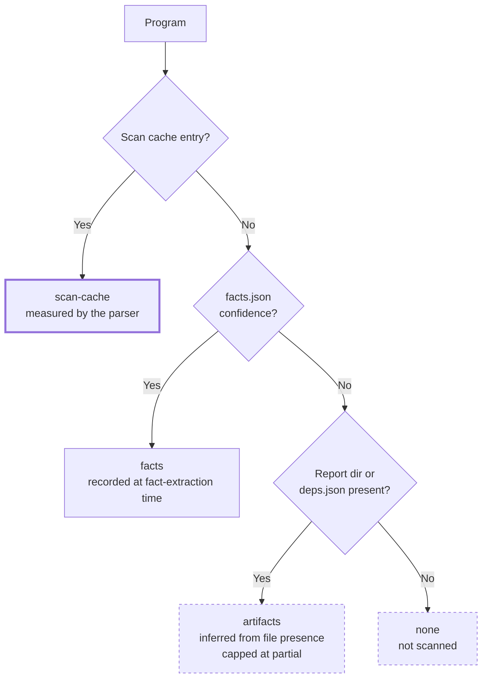
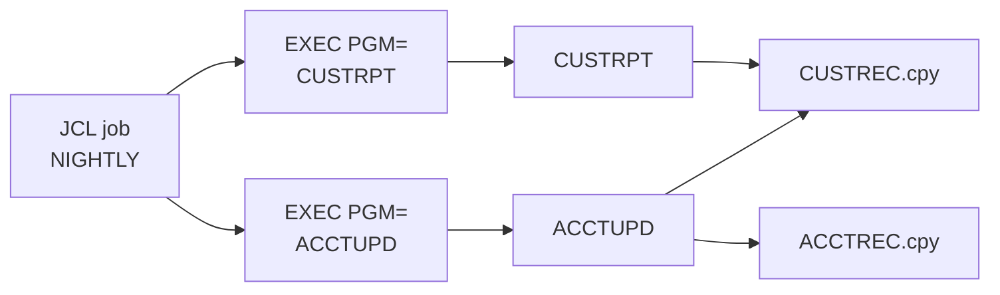
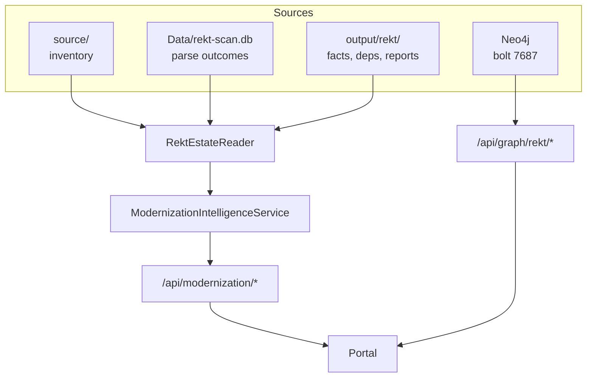

**Last updated**: 2026-10-23

# Dependency Health and Semantic Flow Explorer

This feature answers one question: **which programs can be converted safely right now?**

Every other portal surface is model-assisted and therefore probabilistic. This one is not. It reports only what the REKT parser actually observed — parse fidelity, resolved CALL/COPY edges, JCL job chains and paragraph-level flow — so that conversion order can be decided from evidence rather than from an LLM's summary of the estate.

It is a **preview feature**, like the REKT scan it reads from. Five subviews are labelled placeholders whose endpoints ship with later features; see [Placeholders](#placeholders).

---

## Dependency eligibility: strict versus explicit draft

Fidelity and AST presence are inspection signals, **not conversion authorization**.
The default strict local gate still rejects any incomplete dependency domain, diagnostic,
missing/stale hash, invalid artifact or placeholder contamination for the selected batch.

Explicit `--dependency-mode draft` (or `CONVERSION_DEPENDENCY_MODE=draft`, or
`ConversionSettings.DependencyMode: "draft"`) isolates independently justified **whole programs**.
It does not relax any program's strict evidence requirements. One blocked program no longer
prevents an unrelated fully evidenced program from converting. A selected blocked callee also
blocks its callers. Copybooks remain definition inputs, never standalone draft implementations.
Missing COPY may affect shared fields and control flow; no safe routine, fabricated layout or
affected-routine count is inferred. Finer isolation requires deterministic usage/control-flow
evidence not currently available in this contract.

Draft mode skips reverse engineering/reused context and JCL entry-point generation. It requires
a fresh empty output folder, writes `draft-conversion-plan.json` and `DRAFT-NOT-VERIFIED.txt`
**before model conversion**, and keeps successful subset runs `Partial`, never verified.
The plan identifies each source-relative program, exact missing evidence/input, blocker category
(`artifact-blocker` vs assessable `coverage-gap`), reason and corrective action.
Each gate-derived blocker also preserves its exact `raw` diagnostic. Descriptions distinguish
an unresolved named COPY, a missing callee, an unreadable SQLCA caused by an unavailable
provider, unsupported CICS/file-I/O contexts, domain-specific partial coverage, source/hash
mismatches and missing artifacts; each requires its own corrective action rather than a
generic instruction to supply inputs.
Routine/location are null unless measured; this planner establishes no routine-level impact.
No eligible programs means a persisted blocked plan and zero model conversion calls.
Unsupported SQL/CICS/file-I/O coverage never becomes ready merely by choosing draft.

Portal launch requests (`/api/runs/start`, `/api/estate/slice/convert`) accept
`dependencyMode: "strict" | "draft"`; Mission Control's policy selector supplies explicit opt-in.
`GET /api/estate/draft-plan` without a scan ID remains a read-only assessment of the **configured local source and
`output/rekt` evidence**, explicitly not a historical graph snapshot. It makes no model calls,
parser executions or graph mutations. Graph diagnostics alone cannot establish either strict
or draft eligibility; current source/export/definition hashes and coverage must be validated locally.
AST Explorer keeps evidence and diagnostic text collapsed behind **Evidence & diagnostics**
by default, leaving the graph and source visible. Expand it to inspect blockers or run the
read-only assessment; no diagnostic information is removed.

The AST assessment button always supplies the selected file's `scanRunId`. The server resolves
that named graph scan's completed ingestion record to its recorded native manifest, verifies
that its prepared-source/artifact paths match ingestion, and assesses the manifest's frozen
original sources and artifacts, restricted to the manifest's exact program list (frozen COPY
search inputs can contain additional programs outside that scan). Paths must stay in the named local evidence folder; linked
paths and caller-supplied filesystem paths are not accepted. The response identifies the scan
and manifest, and the UI shows the selected program's blockers rather than another scan's plan.
Missing, unavailable or mismatched bindings return **409 `snapshot-evidence-binding-unavailable`**
with `missingEvidence`, `reason` and `action`; there is no default-directory substitution.
This is a read-only assessment of snapshot inputs, not authorization to convert newer disk bytes.
Changing eligibility does not authorize paid model use: starting a conversion remains a separate
user decision. No model conversions were performed to validate this policy.

Eligible draft programs receive their exact hash-bound `COPY` definitions through
`VerifiedCopybookContext`, called by the shared prompt injector for direct/chunked Java and
C# converters. Definitions remain context/required model declarations, not standalone
conversion units. This mandatory draft context is independent of `ENABLE_REKT_CONTEXT`,
revalidates hashes, excludes unrelated copybooks and bypasses estate-wide ownership/context
inference. A missing or changed required definition fails closed rather than silently omitting
its layout.

Offline planning without AI credentials:

```bash
dotnet run -- dependency-plan --source source --facts output/rekt --output output/new-draft-plan
```

For a frozen named snapshot, explicitly select its `inputs/source` and `artifacts` directories
and write the plan to a separate new directory. No source, evidence or graph data is changed.

## Why fidelity does not gate conversion alone

A program with missing copybooks may still have useful AST structure, while its field layouts
and control flow remain unverified. Never fill that gap with compiling stubs. These legacy
fidelity buckets describe structure, not dependency readiness or behavioral equivalence:

| Fidelity | Meaning | Safe to convert |
|---|---|---|
| `full` | Recorded full structural fidelity | Requires local dependency/hash validation |
| `partial` | AST built, some evidence unresolved | Inspect gaps; no routine isolation inferred |
| `deps-only` | Dependencies extracted, no usable AST | No — resolve copybooks, re-scan |
| `failed` | Parser could not process the file | No — dialect or format problem |
| `not-parsed` | No recorded parse evidence | No — produce parser/export evidence for the exact source |

`ReadinessScore` weights these as `full × 1.0 + partial × 0.5 + deps-only × 0.25`, over non-copybook programs only. `CoveragePct` is the stricter `full ÷ total`. Copybooks are excluded from both because they are includes, not conversion units, and counting them inflates readiness with work that does not exist.

### Fidelity is reported with its source

The same fidelity value carries very different weight depending on where it came from. A value read from the scan cache was measured by the parser. A value inferred from the mere presence of a report directory was not.



Each row carries a `FidelitySource` of `scan-cache`, `facts`, `artifacts` or `none`, and the UI weakens the badge for the latter two. An inferred value is never displayed as a measured one.

Artifact presence is capped at `partial` and can never yield `full`. A stub-backed parse — one where a missing copybook was replaced by a generated stub, so the structural facts are degraded — writes a report directory that is byte-for-byte indistinguishable in shape from a clean one: same `cfg/`, `flow_ast/` and `data_structures/` subdirectories. Since the artifacts on disk cannot separate the two cases, treating their presence as proof of a complete parse would report a degraded estate as fully ready. `./doctor.sh rekt-full` alone writes no scan cache, so this is the common path, not an edge case.

The scan cache is preferred because it is the only source that records a *parse outcome* rather than a by-product of one. It is keyed by basename under the `v1-basename` identity scheme, while facts use `v2-source-relative`. That mismatch is deliberate and is handled explicitly: when a basename maps to more than one source file, the cache entry is ambiguous and is **discarded** rather than attributed to an arbitrary one of them.

---

## The four surfaces

### Dependency Health

The estate-wide roll-up: fidelity buckets, readiness and coverage, missing copybooks with the programs that reference them, and blocked programs.

Missing copybooks come from `output/rekt/missing-copybooks.txt`, written by `doctor.sh` before parsing so that reduced coverage is explicit rather than discovered later. The file is truncated to empty when nothing is missing, which is a valid state and not an error.

### Dependency Topology

The CALL/COPY graph. Node size is lines of code, colour is fidelity, and COPY edges are dashed to distinguish an include from a transfer of control.

Edges whose target cannot be resolved to a known program are **not dropped**. They are listed separately as unresolved, because an unresolved CALL is usually a missing program rather than a parser artefact, and silently omitting it would make the estate look more complete than it is.

### Service Chain

JCL job steps down to the programs they execute and the copybooks those programs include.



Within an estate that has JCL, programs no job executes are rendered standalone rather than hidden — an unscheduled program is a real finding, since it is either dead code or invoked by something outside the scanned estate. An estate with no JCL at all is a different case: the view returns an explanatory note instead of a job-less program list, because "nothing is scheduled" and "there is no schedule to read" are not the same conclusion.

Jobs are read by the [JCL parser](jcl-job-facts.md), so procedures that are in the source are expanded, with their overrides, before steps are read. A step is read for three kinds of evidence, strongest first:

| Evidence | Example | Why |
|---|---|---|
| `EXEC PGM=` on the step card, or on a step of an expanded procedure | `//STEP010 EXEC PGM=CUSTRPT` | Names the program directly |
| `RUN PROGRAM(...)` in in-stream SYSTSIN | `RUN PROGRAM(PAYRB013) PLAN(...)` | DB2 batch runs under the TSO monitor, so the card names `IKJEFT01` rather than the workload |
| The step name, when a source file of that name exists | `//PAYRB016 EXEC PROC=PAYRP02P` | A PROC step is conventionally named after the program it runs; accepted only when corroborated by a real file |

In-stream data is read *before* the system-utility filter is applied, because `IKJEFT01` and the PROCs wrapping it are the monitor rather than the program to convert; discarding the step would discard the only record of what it ran.

Steps whose program cannot be determined — `EXEC PROC=` naming a procedure that is not in the scanned estate — are reported in `unresolvedSteps` rather than dropped, and the response note qualifies the standalone column accordingly. A standalone verdict is only sound once every step is accounted for; until then, absence of a caller is missing evidence rather than a finding.

Program names are matched allowing hyphens, so `EXEC PGM=CUSTOMER-INQUIRY` resolves to the program of that name. Strict JCL member names cannot contain a hyphen, but modernization estates routinely carry hyphenated COBOL names, and truncating at the hyphen silently drops every job-to-program edge.

Filters narrow by job or by program, and combine: requesting a program inside a job that never runs it returns an empty result rather than the program on its own, which would imply a schedule relationship that does not exist. Mermaid output is capped at 200 edges and flags the truncation only when edges were actually withheld; the JSON response always carries the complete graph.

### Semantic Flow Explorer

Per-program procedural detail: paragraphs, sections, PERFORM targets and SQL statements, from the AST the parser produced.

Where an artifact is absent this is reported plainly rather than rendered as an empty flow, because an empty diagram and a program with no artifacts look identical to a reader but mean very different things.

The graph-backed AST explorer counts only native `SECTION` and `PARAGRAPH` nodes.
`PARAGRAPHS` containers may group unsectioned paragraphs but are not sections;
`PARAGRAPH_NAME` children are names, not additional paragraphs. The overview and
status bar use the same deduplicated inventory. The structure API does not measure
statement counts: its count fields are `null`, with `statementCountsAvailable: false`,
and the UI displays **Unavailable**, not zero. The paragraph inspector follows only
`CONTAINS` edges and labels its descendant inventory **AST detail nodes**, not
statements; dialect wrappers and other parser nodes are not executable-statement evidence.
Generic `DIALECT` and `DIALECT_CONTAINER` types are labelled **Embedded** and
**Embedded container**, not SQL: the same native types also contain CICS statements.

The source summary excludes `.preprocessed`, `.rekt-staging`, and `.convert-*`
directory segments, using the same scratch-path rule as the program picker.
These derived parser/conversion copies are not additional estate members.

Graph ingestion loads native AST nodes before CFG relationships, regardless of
artifact directory ordering. Relationship totals count matched endpoints, not
attempted rows; native CFG edges whose endpoints are absent from the AST are
reported explicitly and are not fabricated or counted as loaded.

---

## How the data is read



`RektEstateReader` is the single read path. It walks the source inventory first so that programs which were never scanned still appear — a program missing from the output directory is precisely the one a readiness score must not ignore.

Artifacts are resolved per program in this order, the first hit winning:

| Artifact | Location |
|---|---|
| Facts | `{rektDir}/{source-relative-path}.facts.json` |
| Report | `{rel}.report`, then `{basename}.report`, `{stem}.cbl.report`, `{stem}.report`, `{stem}.CBL.report` |
| Dependencies | `deps.json` within the resolved report directory |

The fallback chain exists because report directory naming has changed across scanner versions and older output directories remain valid input.

The basename-keyed steps of that chain are **skipped entirely when a basename is ambiguous**. Given `billing/CUSTOMER.cbl` and `legacy/CUSTOMER.cbl`, a flat `CUSTOMER.report` or `CUSTOMER-deps.json` cannot say which produced it, so neither program claims it and both report as unparsed. Attributing it to whichever was enumerated first would show a measured fidelity for a program that may never have been scanned.

Lines of code prefer `facts.summary.loc`. Failing that, line feed *bytes* are counted directly — the corpus contains files with unpaired CR and LF characters, which .NET's universal-newline handling splits on independently and double-counts.

Names are preserved exactly as the parser emitted them and compared case-insensitively. Normalising them for storage would make the UI disagree with the source.

---

## Endpoints

| Endpoint | Returns |
|---|---|
| `GET /api/modernization/dependency-health` | Fidelity buckets, readiness, coverage, missing copybooks, blocked programs |
| `GET /api/modernization/topology` | CALL/COPY nodes and edges, plus unresolved edges |
| `GET /api/modernization/service-chain` | JCL → program → copybook chains and Mermaid source. Optional `?job=` and `?program=` |
| `GET /api/modernization/flow/{**identity}` | Per-program procedural detail: `sections` (each with its `paragraphs`), `paragraphCount`, `performEdges`, `sqlStatements` (operation, tables, line) and `callTargets`, plus artifact-presence flags. Reads both the report-directory and flat REKT layouts |
| `GET /api/graph/rekt/runs` | Scan runs with file counts |
| `GET /api/graph/rekt/architect` | Program inventory with AST availability |
| `GET /api/graph/rekt/services` | Service-layer projection with call and SQL counts |

The `/api/graph/rekt/*` group reads Neo4j and degrades to an explanatory banner when the graph is unreachable. The `/api/modernization/*` group reads the filesystem and scan cache, and therefore works without Neo4j running.

---

## Using it

The views need REKT output. Generate it with:

```bash
./doctor.sh rekt-full
```

Then open the portal and select the **Dependency** or **Modernization Intelligence** tab.

The scan-run selector filters to a single run. Runs covering two files or fewer are omitted, as these are single-program re-scans that would empty every view without explaining why. When Neo4j is unreachable the selector disables itself with the reason rather than offering an empty dropdown.

---

## Placeholders

These subviews render a labelled empty state. Their endpoints are not part of this feature and ship later; no placeholder numbers are shown, since a plausible-looking figure on a decision surface is worse than an obvious gap.

- Modernization Dashboard
- Application Explorer
- Service Inventory
- Wave Planning
- Capability Mapping
- Reachability, within the services view

The Runtime subview is no longer wholly a placeholder: it renders the [conversion parity report](conversion-parity-validation.md), while its runtime-telemetry half still has no data source.

---

## Implementation notes

Two constraints are worth knowing before changing this code.

**The scan cache schema is not hand-writable.** `SqliteRektScanCache.EnsureSchema()` compares `PRAGMA user_version` against `StorageSchemaVersion` and drops and recreates `scan_entry` on a mismatch. Always seed through `UpsertAsync`. Rows whose `semantic_invalidation_ver` does not match the current version are skipped silently.

**A vis-network canvas must have a non-growable height.** vis-network sizes itself to its container, so a container that grows to fit its content feeds back into itself. During development this drove the canvas past 50,000px within seconds. `.dashboard-panel` therefore pins `height`, `min-height` and `max-height` together, matching the existing `#dependency-graph` convention.
