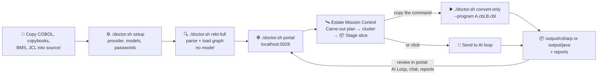

# doctor.sh command reference

**Last updated**: 2026-11-25

**Always use `./doctor.sh run` to run migrations, not `dotnet run` directly.**

The README lists the main commands; this page covers every option.

## The quick run, step by step



| Step | Calls a model? | Needs Docker? | Writes to |
|---|---|---|---|
| `setup` | No (only lists models) | Pulls the Neo4j image | `Config/ai-config.local.env` |
| `rekt-full` | No | Neo4j; REKT parser only when COBOL is present | `source/.preprocessed/` (COBOL), `output/rekt/`, Neo4j |
| `portal` | Only for chat | No for Estate Mission Control; Neo4j for the graph tabs | Nothing (reads) |
| `estate` / Estate Mission Control | No | No (built from `source/` alone) | `output/estate/` |
| `convert-only` / `run` | Yes | Migration Neo4j (started for you) for the dependency graph | `output/<language>/<run>/`, `Data/migration.db`, migration Neo4j |
| `reverse-eng` | Yes | Migration Neo4j | `output/reverse-engineering-details.md`, `Data/migration.db` |
| `jcl` | No | No | `output/<language>/<run>/` |

## Example commands

| Command | What it does |
|---|---|
| `./doctor.sh estate` | Prints the carve-out wave plan in the terminal (same data as Estate Mission Control) |
| `./doctor.sh estate C01` | Prints one cluster and the `convert-only` command for its slice |
| `./doctor.sh run --program X.cbl --language Java --dry-run` | Previews which programs a conversion would include, without calling a model |
| `./doctor.sh convert-only --program A.cbl --program B.cbl` | Converts only these programs (repeat `--program` or separate with commas) |
| `./doctor.sh run --program X.cbl --include-callees --clean-output` | Converts a program plus everything it calls, into a clean output folder |
| `./doctor.sh reverse-eng` | Extracts business logic only (no conversion) |
| `./doctor.sh run` | Full migration of everything in `source/` |

Estate Mission Control builds from `source/` alone. The portal's chat and report pages need at least one run (`./doctor.sh reverse-eng`, `convert-only` or `run`).

**JCL jobs:** put the `.jcl` files (and their `.proc`, `.prc`, `.inc` members) in `source/`, then:

| Command | What it does |
|---|---|
| `./doctor.sh rekt-full` | **Scan JCL (with or without COBOL)**: facts and graph only; no executable scaffolding. Respects `JCL_SOURCE_FOLDER` |
| `./doctor.sh jcl --language CSharp` (or `Java`) | **JCL only, no model, seconds**: generates one job per JCL job into `output/<language>/<run>/`, compiles it (`dotnet build`, or `mvn compile` for Java), and lists per job which programs and procedures are still missing |
| `./doctor.sh run --job NAME --language CSharp` | **Job plus its programs**: converts the COBOL programs the job runs (add `--dry-run` to preview them), then generates the job so it can run end to end |

See [JCL](#jcl) below.

## Main Commands

```bash
./doctor.sh run           # Full migration: analyze → convert → launch portal
./doctor.sh portal        # Launch web portal only (http://localhost:5028)
./doctor.sh reverse-eng   # Extract business logic, persist to DB, launch portal
./doctor.sh convert-only  # Conversion only; prompts to reuse persisted RE context
./doctor.sh convert-only --java-framework Spring # Java Spring Boot instead of Quarkus
./doctor.sh jcl           # Jobs from the JCL alone, no model: what each job still needs
./doctor.sh estate        # Slices and migration waves from the source alone, no model
```

`--java-framework Spring` selects Java explicitly and skips the target-language prompt;
`--java-framework Quarkus` retains the existing Java target. Without flags, the
interactive menu also offers Spring Boot. Framework selection does not waive REKT
dependency requirements or turn a source-isolated partial run into a complete application.

### Business Logic Persistence and --reuse-re

After every `reverse-eng` or full `run`, extracted business logic is persisted to the SQLite database. This enables three distinct conversion modes:

| Mode | Command | RE context in prompts? |
|------|---------|------------------------|
| Full migration | `./doctor.sh run` | ❌ No — RE runs first and writes its report |
| Pure conversion | `./doctor.sh convert-only` → answer **N** | ❌ No context |
| Conversion + cached RE | `./doctor.sh convert-only` → answer **Y** | ✅ Yes — loads persisted results from the last RE run over the same source folder |

Use `./doctor.sh convert-only` and answer **Y** to reuse saved RE results. Keep conversions behind `doctor.sh` so configuration and connectivity checks run before conversion.

Injection is off by default. On IBM Bank-of-Z, converters given the business logic followed the summary instead of translating every paragraph, and dropped error and abend handling. Only a run over the same source folder is reused, so one estate's report never reaches another. A file whose content changed since that run gets no business logic, and the run lists it. The converters treat the report as context: when it disagrees with the COBOL source or the REKT facts, the source wins first and the facts second.

Persisted RE results are visible in the portal — each run card has a **🔬 RE Results** button that shows per-file story/feature/rule counts and lets you delete results you are unsatisfied with.

## Parse first: rekt-full

Run `./doctor.sh rekt-full` once after you put the sources in `source/`, and again whenever they change, **before** a full or partial conversion. It calls no model and needs no sign-in.

It parses every program with REKT, records how much of each program the parser recovered (its *parse fidelity*), lists the copybooks that are referenced but not in the source (`output/rekt/missing-copybooks.txt`), parses the JCL, and loads the result into the REKT Neo4j graph. The conversion, the Estate Mission Control, the AST Explorer and Convert Programs all read from it. Without it, every program shows as *not parsed*, the AST Explorer is empty, and the conversion works from the raw source alone.

```bash
./doctor.sh rekt-full                 # parse + load into Neo4j (rekt-parse and rekt-ingest run the two halves)
./doctor.sh rekt-status               # containers, graph counts and exports
cat output/rekt/missing-copybooks.txt # add these to source/ and run rekt-full again
```

> [!TIP]
> **Parallel parsing for large estates.** By default, programs are parsed one at a time (about 2 minutes each on a laptop, because called programs are parsed with their callers). Add `--parallel N` to parse up to N programs at once in the REKT container:
>
> ```bash
> ./doctor.sh rekt-full --parallel 4            # parse 4 programs at once, then ingest
> ./doctor.sh rekt-parse --parallel 4           # parse only
> REKT_PARSE_JOBS=4 ./doctor.sh rekt-full       # same, via a shell environment variable
> ```
>
> | Setting | Meaning |
> |---|---|
> | `--parallel N` / `REKT_PARSE_JOBS=N` | 1–16 programs at once. Defaults to `1` (sequential). The flag overrides the variable. |
> | Recommended N | 2–4. Each job runs its own parser JVM next to Neo4j, so allow about 1 GB of Docker memory per job. Too many jobs causes swapping and slows the scan. |
> | Incremental | Unchanged programs with valid evidence are skipped as `(cached)` before any job starts. A rerun after a small change takes minutes. |
>
> The results are identical to a sequential scan. Each program has its own work folders. The scan cache and the Mission Control activity journal are merged in program order (the journal uses a file lock). Each program's console output is printed as one block when it finishes. If any program stops with an internal error, the scan waits for the running jobs and then fails; nothing is ingested.

> [!IMPORTANT]
> **Several estates in one `source/` folder.** When programs sit in more than one top-level folder of `source/` (for example `source/bank-of-z/` and `source/carddemo/`), each folder is an independent estate. Loose files directly in `source/` form one more estate. Each estate is preprocessed and staged on its own, so its programs resolve COPY and CALL only within that folder (subfolders included, such as `cbl/`, `cpy/` and `jcl/`). Scanning one estate never changes another's evidence, and each estate binds to its own snapshot of the platform contracts (`<estate>/.preprocessed/platform-contracts.json`). Editing the shared contracts profile therefore only affects estates that you scan again.
>
> When programs sit in only one top-level folder (a layout such as `source/cbl/`, `source/cpy/` and `source/jcl/`), all of `source/` is one estate, and programs find copybooks in the sibling folders. If `source/` holds several estates and a top-level folder has copybooks or BMS maps but no programs, the parse warns that no estate reads it; move it into the estate folder that uses it.
>
> In Estate Mission Control, a JCL job in a folder without programs (such as `source/jcl/`) is shown in the estate of the programs it runs.

Read the summary at the end before converting:

```
  Parsed: 117 succeeded (0 from cache), 0 failed
  ⚠️  2 program(s) parsed with reduced fidelity (partial / dependencies-only / raw AST):
      cbl/ACCT01.cbl(DepsOnly) cbl/RPT07.cbl(Partial)
  ⚠️  38 missing copybook(s) — see output/rekt/missing-copybooks.txt
```

A missing copybook remains an unresolved dependency: its fields and layout must not be inferred or fabricated. Missing-copybook-only parser recovery can retain partial evidence with diagnostics; it does not establish a complete AST or make conversion ready. Add the real copybooks and parse again. Parser output for each program goes to `output/rekt/**/*.parse.log`, not the terminal; a failed program prints its last errors and the log path. Set `REKT_VERBOSE=true` to stream the parser output as well.

While it runs, each stage prints its duration and each program gets one line, for example `✅ Full  cbl/COSGN00C.cbl  14s · AST ✓ CFG ✓ data ✓  [12/46 · 3 running · ~4m left]`. The AI Loop tab in the portal shows the same progress and a live feed of these lines.

The parser bundles declared SQLCA and SQLDA reference inputs when no accepted
source definition exists. See [bundled system copybooks](bundled-system-copybooks.md)
for provenance, licensing and the distinction from a customer's installed SDK.

CICS screen layouts can be derived from real definitions rather than guessed: if `source/` holds the BMS mapsets (`*.bms`), the parse generates symbolic map copybooks (`<map>I` / `<map>O`) from them. The copybook takes the `.bms` file name, and a real copybook of that name always wins. These generated layouts still require validation; they do not establish complete program parsing or conversion by themselves. Set `REKT_NO_BMS_MAPS=true` to turn this off.

The same BMS parser also writes `bms-screen-definitions.json` into each estate's `.preprocessed/` folder (`source/.preprocessed/` for loose root files, `source/<estate>/.preprocessed/` for an estate folder): source paths and hashes, map dimensions, field positions, initial text, protection/numeric attributes, and unnamed labels and zero-length attribute boundaries. Named symbolic-copybook fields remain separate from visual fields. Invalid lengths or coordinates produce explicit warnings rather than invented one-byte fields. This manifest can drive a web adapter; having a rendered layout does **not** prove that its COBOL screen program, CICS SEND/RECEIVE operations, transaction navigation, or missing vendor copybooks have been converted.

Then convert, either everything or a selection:

```bash
# Full conversion
./doctor.sh run                                            # reverse engineering + conversion + portal
./doctor.sh convert-only --language Java                   # conversion only

# Partial conversion
./doctor.sh convert-only --language Java --program ORDMAIN.cbl --dry-run   # preview, no model call
./doctor.sh convert-only --language Java --program ORDMAIN.cbl --program ORDDATE.cbl
./doctor.sh convert-only --language CSharp --program orders/cbl/ORDMAIN.cbl --include-callees
./doctor.sh run --job NITEJ001 --language CSharp           # a JCL job and the programs it runs
```

`--program` takes the program name, or its path relative to `source/` when two programs share a name. It can be repeated or comma-separated. `--include-callees` also converts every program the selection CALLs. Copybooks are always carried in by the programs that COPY them. The [Convert Programs](portal.md#convert-programs) tab and the [Estate Mission Control](portal.md#estate-mission-control) build these commands for you.

## JCL

JCL does not go through REKT (REKT parses COBOL only). It is read by a built-in deterministic parser, and the jobs are generated from it without a model. Put the JCL, with its catalogued procedures and `INCLUDE` members, in `source/` beside the COBOL.

| Command | What happens to the JCL |
|---|---|
| `./doctor.sh jcl` | Parses the JCL and generates one job per JCL job into a new run folder, without converting anything, and compiles them (C# with dotnet, Java with Maven when installed). Lists, per job, the programs not yet converted and the steps that cannot run, usually because a procedure is missing from the source. Takes seconds and calls no model. |
| `./doctor.sh run --job NAME` | Converts the programs that job runs, and what they CALL when the portal is up, then generates the jobs. Each of those programs is converted with the batch-program contract, so the job runner can call it. A program the job runs that is not in the source is listed, not converted. |
| `./doctor.sh run` / `convert-only` | The same, for every program. Jobs are generated for every JCL job. |
| `./doctor.sh rekt` / `rekt-full` | Also writes a facts file per job and the dataset lineage between jobs to `output/rekt/` (`*.job.json`, `jcl-lineage.json`). The portal's Service Chain uses them. |

To convert a batch application so that it runs, convert the programs together with their jobs (`run --job`, or `run` for all of them). Converting the JCL alone gives jobs whose program steps abend with `S806` until the programs exist. `--job` takes a job name or a member name and can be repeated or comma-separated; it also works with `convert-only` and `--dry-run`:

```bash
./doctor.sh jcl --language CSharp                          # what the jobs need
./doctor.sh run --job NITEJ001 --language CSharp --dry-run  # which programs that converts
./doctor.sh run --job NITEJ001 --language CSharp            # convert them, with the job
```

Turn job generation off with `JCL_JOBS_ENABLED=false`. If the JCL lives outside `source/`, point to it with `JCL_SOURCE_FOLDER`. To run the parser or the generator without `doctor.sh`:

```bash
dotnet run -- jcl-facts source --output-dir output/rekt
dotnet run -- jcl-jobs source --language CSharp   # or Java; a new run folder under output/<language>/
dotnet run -- jcl-programs source --jobs NITEJ001 # the programs a job runs
```

See [JCL job facts](jcl-job-facts.md) and [Jobs generated from JCL](jcl-jobs.md).

## doctor.sh run - Interactive Options

When you run `./doctor.sh run`, you'll be prompted:

```
╔══════════════════════════════════════════════════════════════╗
║   COBOL Migration - Target Language Selection                ║
╚══════════════════════════════════════════════════════════════╝

Select target language:
  [1] Java Quarkus
  [2] C# .NET

Enter choice (1-2): 
```

After migration completes:
```
Migration complete! Generate report? (Y/n): Y
Launch web portal? (Y/n): Y
```

## Speed Profile

After selecting your action and target language, `doctor.sh` prompts for a **speed profile** that controls how much reasoning effort the AI model spends per file. This applies to migrations, reverse engineering, and conversion-only runs.

```
Speed Profile
======================================
  1) TURBO
  2) FAST
  3) BALANCED (default)
  4) THOROUGH

Enter choice (1-4) [default: 3]:
```

| Profile | Reasoning Effort | Max Output Tokens | Best For |
|---------|-----------------|-------------------|----------|
| **TURBO** | Low on ALL files, no exceptions | 65,536 | Testing, smoke runs. Speed from low reasoning effort, not token starvation. |
| **FAST** | Low on most, medium on complex | 32,768 | Quick iterations, proof-of-concept runs. Good balance of speed and quality. |
| **BALANCED** | Content-aware (low/medium/high based on file complexity) | 100,000 | Production migrations. Simple files get low effort, complex files get high effort. |
| **THOROUGH** | Medium-to-high on all files | 100,000 | Critical codebases where accuracy matters more than speed. Highest token cost. |

The speed profile works by setting environment variables that override the three-tier content-aware reasoning system configured in `appsettings.json`. No C# code changes are needed — the existing `Program.cs` environment variable override mechanism handles everything at startup.

See [Speed Profiles](speed-profiles.md) for the environment variables each profile sets and the complexity scoring.

## Other Commands

```bash
./doctor.sh               # Health check - verify configuration
./doctor.sh test          # Run system tests
./doctor.sh setup         # Interactive setup wizard
./doctor.sh chunking-health  # Check smart chunking configuration
```

## Explicit partial draft conversion

Strict dependency verification remains the default. To convert only independently justified
whole programs while retaining explicit blocked plans, use `--dependency-mode draft` on the
.NET migration CLI, or `CONVERSION_DEPENDENCY_MODE=draft` with existing launch commands.
Mission Control and estate slice launches expose the same explicit policy. Draft requires a
fresh output directory and is always **partial / not verified**; missing COPY and unsupported
dependency domains are not waived. See [dependency eligibility](dependency-health-and-flow-explorer.md#dependency-eligibility-strict-versus-explicit-draft)
for the plan artifact, corrective-action contract, read-only planning API and current routine-isolation limits.

## Reverse engineering only

`./doctor.sh reverse-eng` extracts business logic without converting. See [Reverse engineering reports](REVERSE_ENGINEERING_ARCHITECTURE.md#reverse-engineering-reports) for what it produces.

## Build and run

### Build Only

```bash
dotnet build
```

### Run Migration (Recommended)

```bash
./doctor.sh run      # Interactive - prompts for language choice
```

**⚠️ Do NOT use `dotnet run` directly** - it bypasses the interactive menu and configuration checks.

### Launch Portal Only

```bash
./doctor.sh portal   # Opens http://localhost:5028
```

## Helper scripts

`helper-scripts/` holds small shell scripts for checking on and resetting a local install. `./doctor.sh run` stays the way to start a migration; these scripts do not replace it. Run them from the repository root, because several use relative paths such as `Data/migration.db`.

| Script | What it does |
|---|---|
| `./helper-scripts/status.sh` | Checks whether the portal port and the Neo4j container are running and prints the URLs. |
| `./helper-scripts/track-progress.sh [--watch] [--run-id N]` | Reads the SQLite database and shows migration progress. `--watch` refreshes every 3 seconds; `--run-id N` selects a run. |
| `./helper-scripts/monitor-progress.sh [source-dir]` | Live view of chunking and file progress for large inputs. The source directory defaults to `source`. |
| `./helper-scripts/demo.sh` | Starts Neo4j and the portal without running a new migration, to browse existing data. Needs `docker` and `dotnet`. |
| `./helper-scripts/open-portal.sh` | Opens the portal in a browser when it is running, trying VS Code, `xdg-open`, `open` and `$BROWSER` in turn. |
| `./helper-scripts/verify-data-persistence.sh` | Checks that `Data/migration.db` exists, that the Neo4j Docker volumes exist, and that `Data/` is gitignored. |
| `./helper-scripts/verify-port-standardization.sh` | Searches the repository for leftover references to the old port 5250 (the portal port is 5028) and runs a few related port checks. |
| `./helper-scripts/cleanup-databases.sh` | Asks for confirmation, then deletes `Data/migration.db` (and its journal/WAL files) and removes the Neo4j containers and volumes. This cannot be undone. |

`helper-scripts/test_mcp_communication.sh` is a developer test script that changes into a hard-coded local path (line 4); edit that path before using it.
