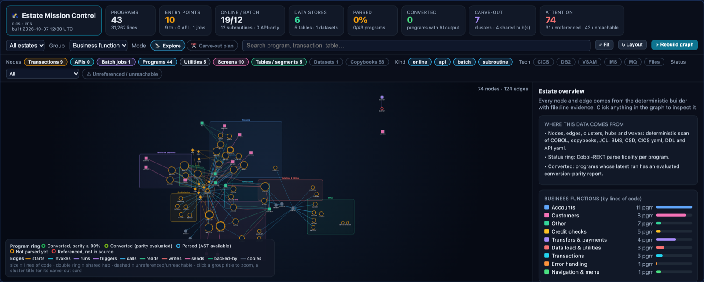
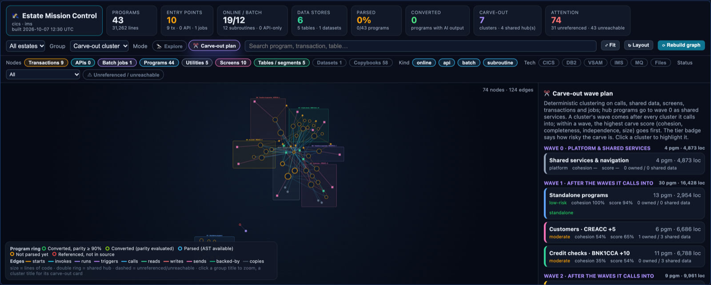
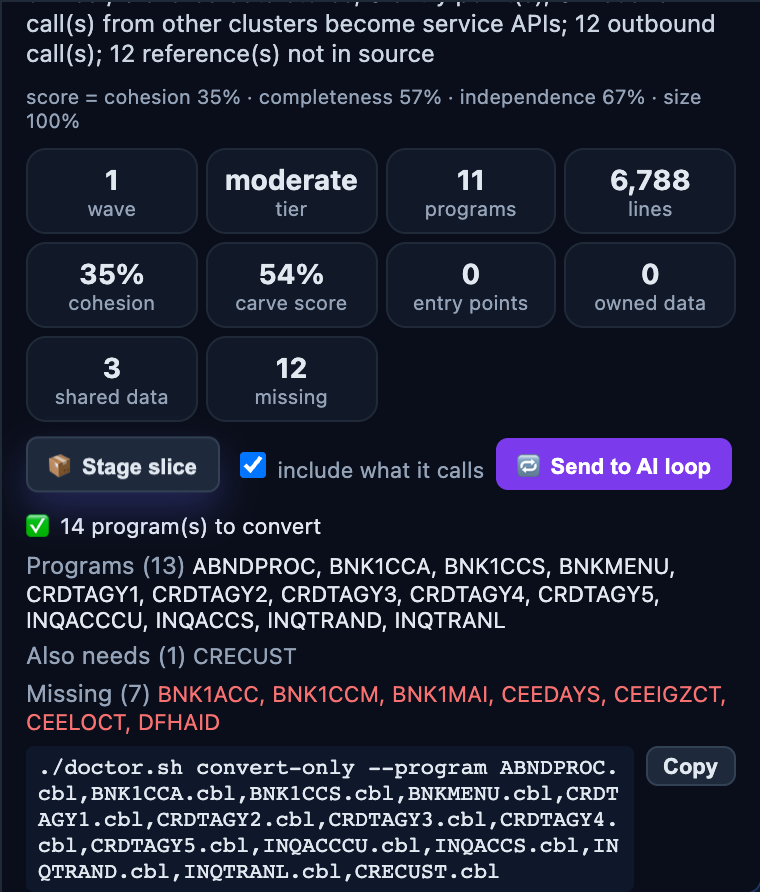
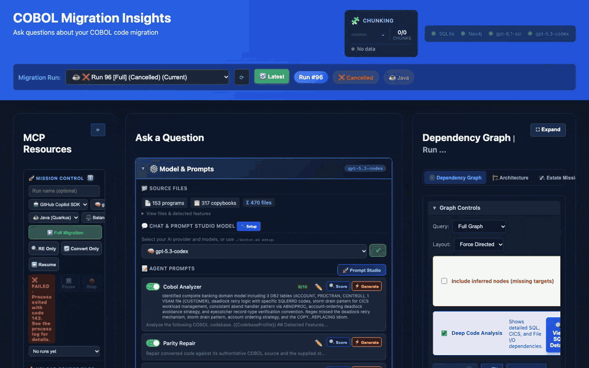
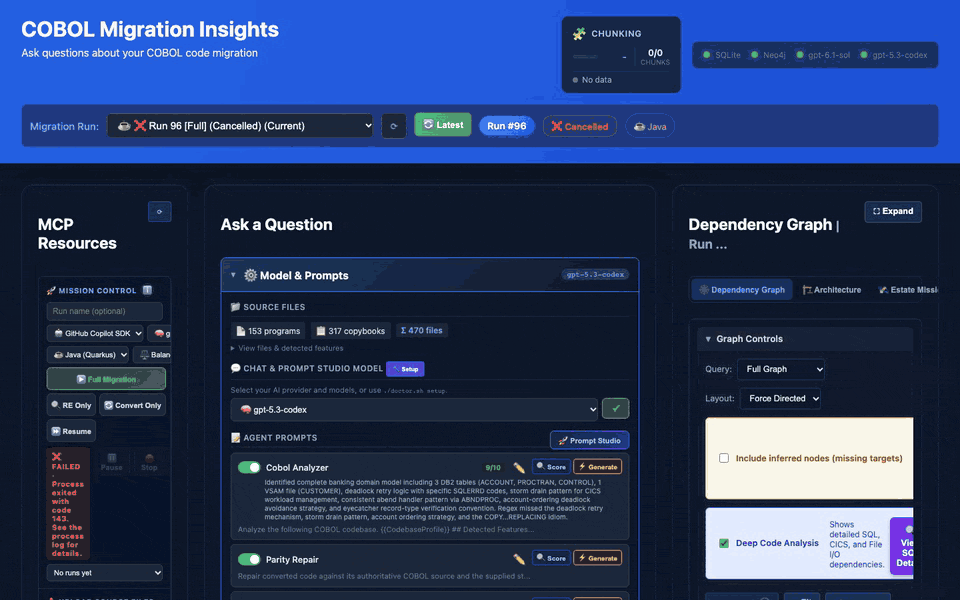
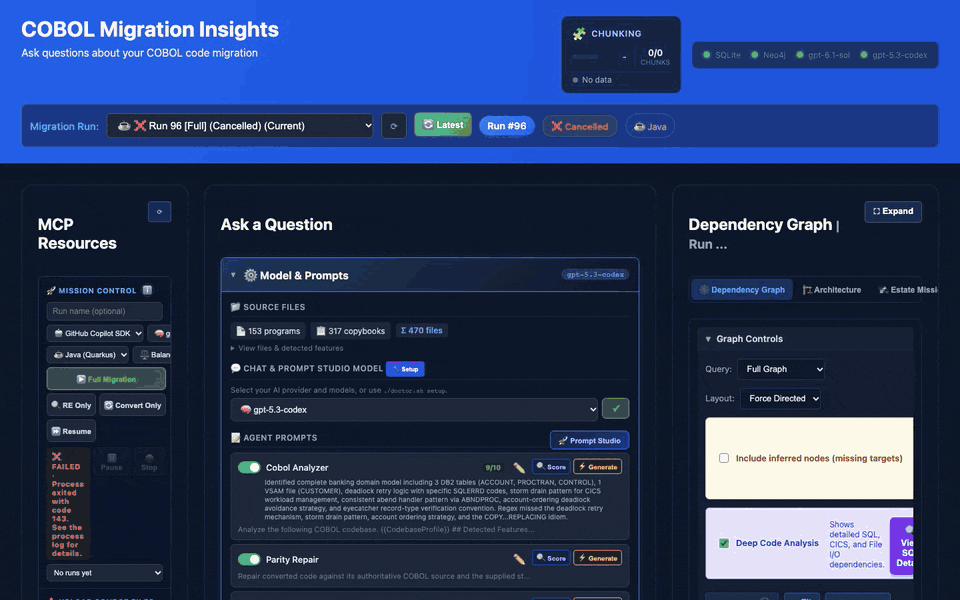
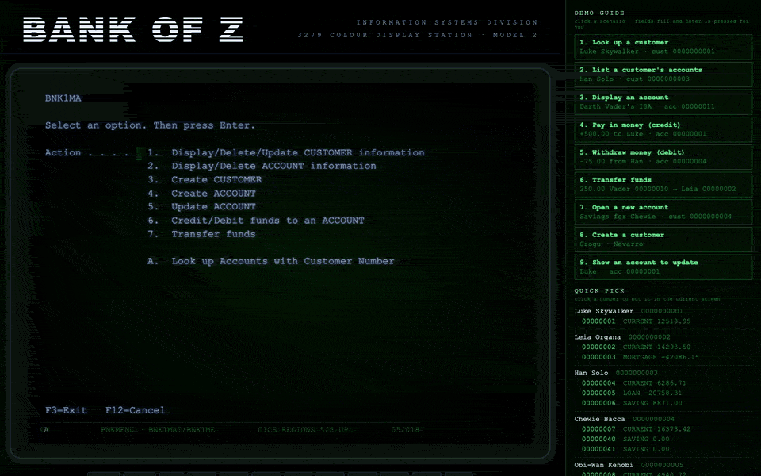

# Portal

**Last updated**: 2026-11-18

`./doctor.sh portal` (or the end of `./doctor.sh run`) opens the portal at http://localhost:5028. Related deep dives: [Estate Mission Control and the AI Loop](estate-mission-control.md), [Ask the Report](ask-the-report.md), [Dependency Health and Semantic Flow Explorer](dependency-health-and-flow-explorer.md).

## Tabs

| Tab | What it shows |
|---|---|
| 🕸 Dependency Graph | Programs and copybooks with their CALL, COPY and file dependencies |
| 🏗️ Architecture | The REKT graph as layers, components, a technology map, dependencies, modules and reachability |
| 🛰 Estate Mission Control | The whole estate as one graph, and the carve-out plan |
| 🔁 AI Loop | Model calls, retries, fallbacks and quality gates per run |
| 🧭 Modernization Intelligence | Measured facts per program from the parse, each with its source |
| 🌳 AST Explorer | What the parser recovered for one program, next to its source |
| 🎯 Convert Programs | Choose programs and get the conversion command |
| 🔎 Program Explorer | One program: what it is, what it touches, what the parser knows about it, and whether that is enough to convert it |
| 🧩 Missing Copybooks | Copybooks referenced but not in the source, ordered by how many programs each affects |

The tabs that read parse results need `./doctor.sh rekt-full` first.

## Estate Mission Control

Open **🛰 Estate Mission Control**. The panel expands to full width. Screenshots: [Estate Mission Control at a glance](#-estate-mission-control-at-a-glance). Everything on it is built from the source without a model, and every node and edge records the file and line it came from.

- **KPIs** across the top: programs and lines, entry points (transactions, APIs, batch jobs), online and batch programs, data stores, how many programs REKT parsed, how many have a converted output, carve-out clusters and shared hubs, and programs that need attention (unreferenced, unreachable, or referenced but not in the source).
- **Explore** mode draws the estate as one graph. Use **Group** to group by business function, carve-out cluster or estate, the **Nodes**, **Kind**, **Tech** and **Status** chips to filter, and the search box to find a program, transaction or table. The ring around a program shows its dependency-evidence state: missing, rejected, check passed or not checked. Parse fidelity and conversion parity are separate observations. Select a node for its metrics, description, conversion parity and every relationship with its evidence. The right panel shows the inputs scanned, the programs per business function and the list that needs attention.
- **Carve-out plan** mode shows the migration waves. Wave 0 holds the hub programs as shared services; each later wave can be converted once the waves it calls into are done. Each cluster is tiered **low-risk**, **moderate** or **core** by its carve score.
- **Cluster card**: select a cluster card, or a cluster title in the graph, to see why the cluster was formed, its members and entry points, the data it **owns** (moves with it) and the data it **shares** with other clusters (needs a data-access API or sync), the inbound calls that become service APIs, its outbound dependencies and what is missing from the source.
- **Stage slice** lists the programs to convert, what they call outside the cluster, what is missing and the equivalent `./doctor.sh convert-only --program …` command. **Send to AI loop** starts that conversion in Java or C#, using the provider and model selected in Mission Control. Follow it on the **🔁 AI Loop** tab.
- **Rebuild graph** rescans the source. Use it after adding files to `source/`.

The graph renders without waiting for the full dependency-readiness assessment.
**Refresh readiness** updates evidence statuses and details without rebuilding or
relaying out the graph. Pending checks are not displayed as passed.

**Input availability** in the overview and program details distinguishes present
hash-matching bindings, shared source paths, configured inputs outside the source
tree, unmatched local filenames, placeholders, unbound candidates, stale evidence
and unreadable files. Shared means outside the program's top-level source folder;
it is not a rejection. Overview counts are deduplicated within the selected estate,
using the most restrictive status when bindings disagree. Missing or invalid
inventory is shown as unknown, never as zero dependencies. Unresolved declarations
and exporter bindings, unsupported parser constructs and unverified target-runtime
mappings have separate explanations and actions.
Availability does not authorise conversion or establish behavioral equivalence.

**Send to AI loop does not run the parser.** Strict conversion reads evidence from
`REKT_FACTS_FOLDER`, defaulting to `output/rekt`. A scan saved elsewhere does not
automatically bind a conversion to that snapshot's sources and artifacts. If a
run stops before its first model call with `missing dependency-evidence.json`,
the required evidence is absent from the conversion's facts directory; changing
the model will not fix it. Supply matching source/evidence inputs and regenerate
stale facts before retrying. Do not bypass the strict gate.

The same plan is available from the command line:

```bash
./doctor.sh estate        # waves, clusters and hubs
./doctor.sh estate C01    # the slice of cluster C01, with its convert-only command
```

See [Estate Mission Control and the AI Loop](estate-mission-control.md) for how clusters, carve scores and waves are computed, the endpoints and the configuration.

### 🛰 Estate Mission Control at a glance

Shown here with the public IBM Bank-of-Z sample in `source/`.

**Estate overview:** every program, transaction, screen, table and copybook, grouped by business function.



**Carve-out plan:** clusters ordered into waves, each with a risk tier, cohesion and carve score.



**Stage slice:** the programs to convert, what they also need, what is missing from `source/`, and the command to run.



## AST Explorer

Open **🌳 AST Explorer** and choose a program from the list at the top. JCL jobs appear in the same list as `JCL · <job>`. The list is filled from the REKT graph, so it is empty until `./doctor.sh rekt-full` has run.

Changing snapshots cancels the previous inventory request; an inventory taking
longer than 15 seconds shows a timeout rather than an indefinite loading state.
The `graph-ingest` schema includes a program/snapshot AST index for these lookups;
existing graphs need the updated schema applied, not just a portal rebuild.

- The bar under the list counts the program's sections, paragraphs, statements and PERFORM calls.
- The left side draws the parse tree: sections, paragraphs, sentences and statements (SQL, CICS, MOVE, PERFORM, IF), with PERFORM targets linked. Hover a node for its type, name and line range. **Raw AST** shows the tree as the parser produced it.
- Select a section or paragraph to show its source on the right, with the line highlighted. **Full File** shows the whole program.

Use it to check what the conversion will work from: a program whose parse fidelity is *Deps only* has no paragraphs or statements here.

The evidence overview separates **recorded AST structure** (useful for navigating sections and source) from **dependency readiness** and **parser/source health**. It counts files with diagnostics, reports with no recorded diagnostics, and unavailable reports for the selected snapshot only; JCL is excluded from COBOL evidence counts. Shared diagnostic codes show why many or even all files may be flagged. For example, an export failure or source-hash verification failure across every file is an evidence-pipeline problem, not proof that every program is missing copybooks or has unusable structure.

When the snapshot records `expectedProgramCount`, `astProgramCount` and `structuralGaps`, the overview also shows the full program inventory versus AST-bearing programs (for example, **78/117 programs with AST; 39 without AST**) and a collapsed list of recorded missing-AST program names. The file picker itself contains AST-bearing files only. Older snapshots without these metadata retain **unknown** totals/names; visible file counts are never substituted for the full program inventory. These counts measure programs with recorded structural artifacts, not percentage AST completeness.

Select a file for exact recorded missing COPY/source names, reasons and corrective actions. Other diagnostics are grouped separately as parser diagnostics, unsupported coverage, unverified inputs, analysis/export failures, incomplete/not-recorded evidence or unclassified diagnostics. Expand **All recorded diagnostics** for the original messages. Source locations are displayed only when recorded; the current graph stores strings, not structured diagnostic locations, so locations embedded in original messages are preserved verbatim and unavailable locations are explicitly marked. Supply real missing inputs and correct search paths, parser configuration or evidence provenance as indicated, then regenerate evidence into a **new named snapshot**, never overwrite an old one or substitute placeholder definitions.

**Unreadable COPY inputs** are separate from missing inputs: `native:unreadable-copybook:SQLCA:Provider "implicit" not installed` records a provider/configuration failure, not proof that the real SQLCA file is absent. The selected-file details preserve the input name and exact diagnostic and direct you to correct provider configuration/input access before regenerating evidence.

A clean-file label means **no diagnostics recorded**, not “fully dependency-ready.” The graph inventory records report presence and diagnostic strings, but does not expose the complete coverage, absence proofs and verified source hashes required by the strict conversion gate. Consequently this view cannot prove any file fully dependency-ready, even if its report is clean. Neither AST node counts nor a small number of missing definitions measure percentage completeness or prove behavioral correctness: a mostly useful structural tree can coexist with a small but blocking missing input. Strict conversion gating, run-scoped source selection and exact snapshot isolation remain unchanged.

## Convert Programs

Open **🎯 Convert Programs** to choose what to convert.

1. **The list** has one row per COBOL program: a compilable unit with a `PROGRAM-ID` and a `PROCEDURE DIVISION`. Copybooks are not listed; they are record layouts, and each is carried in by the programs that COPY it. Filter by name or path in the top right.
2. **Parse fidelity** on each row comes from `rekt-full`. Hover a label for its meaning:
   - **Parse: Full**: the recorded structural parse outcome is Full, shown neutrally rather than as approval. Conversion may still be blocked by missing or unverified inputs, incomplete exported coverage or unresolved runtime bindings.
   - **Parse: Partial**: the parser recovered only part of the structure, for example because of a missing copybook or unsupported dialect. Missing layouts remain blocking dependencies; conversion must not invent them.
   - **Deps only**: only the dependency list was recovered, so there is much less to convert from.
3. **Details** shows what converting that program would pull in: its call closure (the programs reachable by CALL), its copybooks and its missing copybooks.
4. Tick the programs you want, choose **Java** or **C#**, and tick **Add call closure** to add every program the selection CALLs (the same as `--include-callees`), so a converted program never calls one that was not converted.
5. **Convert selection** shows the command for the selection. The button does not start a run; copy the command into a terminal:

```bash
./doctor.sh convert-only \
  --language Java \
  --program orders/cbl/ORDMAIN.cbl \
  --program orders/cbl/ORDDATE.cbl
```

Add `--dry-run` to see what would be converted without calling a model. Running it through `doctor.sh` rather than `dotnet run` adds the concurrent-run guard and the retry and failure handling. To start a conversion from the portal instead, use **Send to AI loop** on a cluster in Estate Mission Control.

## Portal features

- ✅ Dark theme with modern UI
- ✅ Three-panel layout (resources/chat/graph)
- ✅ AI-powered chat interface
- ✅ Suggestion chips for common queries
- ✅ Interactive dependency graph (zoom/pan/filter)
- ✅ Multi-run queries and comparisons
- ✅ File content analysis with line counts
- ✅ Comprehensive data retrieval guide
- ✅ Enhanced dependency tracking (CALL, COPY, PERFORM, EXEC, READ, WRITE, OPEN, CLOSE)
- ✅ Migration report generation per run
- ✅ Mermaid diagram rendering in documentation
- ✅ Collapsible filter sections for cleaner UI
- ✅ Edge type filtering with color-coded visualization
- ✅ Line number context for all dependencies
- ✅ Per-run **🔬 RE Results** button — view persisted business logic extracts and delete unsatisfactory results
- ✅ **AI Provider Setup Modal** — connect to Azure OpenAI or GitHub Copilot SDK from the browser, discover all available models/deployments, and save config
- ✅ **Mission Control** — start/stop/pause migrations, select provider and model, upload source files
- ✅ **Prompt Studio** — generate, AI-enhance, and score agent prompts (works with both Azure and Copilot SDK)
- ✅ **Estate Mission Control** — the whole estate as one graph, and a carve-out plan of clusters, owned and shared data, and waves, with source evidence; convert one slice at a time ([details](#estate-mission-control))
- ✅ **AST Explorer** — the parse tree of one program beside its source ([details](#ast-explorer))
- ✅ **Convert Programs** — choose programs by parse fidelity and call closure, and get the `convert-only` command ([details](#convert-programs))
- ✅ **AI Loop** — per-run model calls, retries, fallbacks, stages and quality gates ([details](estate-mission-control.md#ai-loop))

## Three-Panel Portal UI

```
┌─────────────────┬───────────────────────────┬─────────────────────┐
│  📋 Resources   │      💬 AI Chat           │   📊 Graph          │
│                 │                           │                     │
│  MCP Resources  │  Ask about your COBOL:   │  Interactive        │
│  • Run summary  │  "What does CUSTOMER.cbl │  dependency graph   │
│  • File lists   │   do?"                   │                     │
│  • Dependencies │                           │  • Zoom/pan         │
│  • Analyses     │  AI responses with        │  • Filter by type   │
│                 │  SQLite + Neo4j data      │  • Click nodes      │
└─────────────────┴───────────────────────────┴─────────────────────┘
```

**Portal URL:** http://localhost:5028

## Portal demo

The portal (`./doctor.sh portal`, http://localhost:5028) shows your estate, what the agents did, and what the parser saw. The three demos below use the public Bank-of-Z sample.

### Estate Mission Control: Bank-of-Z



> [!NOTE]
> **What you are seeing:** a map of every program, CICS transaction, API, DB2 table and data store in the estate. It is built deterministically from source (COBOL, copybooks, BMS, CICS definitions, DDL and JCL), with no model calls.
>
> - **Pick an estate** (here Bank-of-Z) to focus the graph.
> - **Click any node** to light up its connections. The side panel lists its calls, reads and writes, each with `file:line` evidence. The demo walks from transaction `OMEN` to the `BNKMENU` menu, the `CRECUST` program, the `ACCOUNT` table, and `ABNDPROC`, the shared abend handler and most connected program.
> - **Program rings** show the dependency check: green means ready to convert, yellow means evidence is missing.
> - **Search** finds any program, transaction or table.
> - **Carve-out plan** groups programs into candidate service slices and migration waves, with the data each slice owns.
>
> See [Estate Mission Control](#estate-mission-control).

### AI Loop: what the agents actually did



> [!NOTE]
> **What you are seeing:** a timeline of each run, built from recorded evidence rather than inferred progress.
>
> - **Pick a run** from the dropdown. Model runs show the loop: Discover, Analyze, Convert, Test, Compile, Parity and Report, with a gate result on each stage.
> - **Context handoffs** list which source files and copybooks each agent received, and whether earlier context was reused.
> - **Native REKT scans** (parse only) appear too, with real stage timings and no model calls.
> - **Follow newest** switches to the live run so you can watch a conversion as it happens.

### AST Explorer: Structure and Raw AST



> [!NOTE]
> **What you are seeing:** the parsed structure of each COBOL program, side by side with its source.
>
> - **Structure view:** expand a section and click a paragraph. The source jumps to it, and the Inspector shows its statement mix (MOVE, IF, PERFORM and so on).
> - **Raw AST view:** the parser's own nodes. Hover a node for its type, name and parser ID. Click a statement to see the exact COBOL the parser captured, or a paragraph to open its source range.
> - **Why it matters:** check for parse gaps before you convert. A statement missing from the AST was not parsed, so structure-based evidence (call graphs, readiness checks, structural context) cannot account for it. The conversion prompt still carries the source text, so a gap is a verification risk rather than proof the model never saw the line.
>
> See [AST Explorer](#ast-explorer).

### Converted Bank-of-Z: 80s terminal and side-by-side code



> [!NOTE]
> **What you are seeing:** the 32 Bank-of-Z COBOL/CICS programs converted to Java Spring Boot microservices and running. The demo uses fictional sample data.
>
> - **80s terminal:** an IBM 3270-style screen rendered from the original BMS maps, driven by the converted Java. One-click scenarios look up a customer, display an account, and transfer funds. The transfer updates both accounts and writes a PROCTRAN audit row in one transaction.
> - **Comparison page:** conversion time, the five services (each former CICS region is a service, and cross-domain LINKs became REST calls), and a code browser with the original COBOL on the left and the generated Java on the right.

> [!IMPORTANT]
> **The code is mapped 1:1 on purpose.** One COBOL program becomes one Java class, paragraph by paragraph, so you can trace each COBOL step to its Java equivalent. This is a way to show that the AI understood the COBOL, not a recommended target design. A real modernization would refactor further into idiomatic services and domain models.
