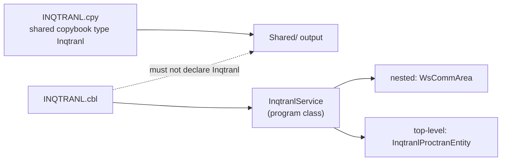

**Last updated**: 2026-11-18

# Source decoding and generated output ownership

COBOL source reads use strict UTF-8, optionally with a UTF-8 BOM. Invalid UTF-8 falls back to ISO-8859-1 (Latin-1). Only consecutive DOS EOF bytes (`0x1A`) at the end are removed; interior EOF characters and source literals remain unchanged. This is a bounded export compatibility policy, not EBCDIC, Windows-1252, or UTF-16 detection.

File scanning, source-backed facts, structural-context fallback, shared-type and ownership registries, stub-copybook discovery, estate program scanning, and the scan-cache graph builder use the same reader. JSON artifacts and generated target source retain their existing readers. Facts hashing uses the decoded source; decoding never fabricates parser evidence.

The writer returns the actual saved path and assigns it to `CodeFile.FilePath`. Callers must retain that path, not reconstruct a path from the original name. Explicit output directories remain authoritative; the writer neither redirects fixtures nor forces service packages.

Each output directory contains `.generated-owners/` claims keyed by a case-insensitive relative target path. Claims persist the exact source-relative identity supplied by `OriginalSourcePath`, including directory and extension. Different sources targeting the same file fail explicitly, including program/copybook pairs and case-only target differences. They are not renamed or combined. A known source may retry or update its own target after reloading the writer. Unknown source identities and unclaimed existing files cannot be overwritten. Keep the claims with generated output when resuming a run. Claims are established before a write and serialized through an exclusive per-target lock; a failed write remains reserved for the same source.

The current CALL and COPY registries address sources by case-insensitive stem within each kind. Ambiguous same-kind stems are rejected in sorted path order before assigning ownership. A program and copybook with the same stem remain distinct. Supporting ambiguous references requires an explicit path-aware resolver; silently merging their contents is not supported.

C# compile repair maps each generated file's actual `FilePath` through its `OriginalSourcePath` to the exact original source content. Relative source identities resolve only against the explicitly supplied source directory. Every AI repair task receives that source, including distinct files with identical basenames. Missing mappings fail rather than falling back to basename matching. The existing missing-type layout planner receives only unique normalized member names; if a repair needs a layout with ambiguous source ownership, it fails explicitly before AI repair. Existing stem-dictionary callers remain supported, but duplicate normalized names are rejected rather than taking the first layout.

Java response extraction masks comments, quoted strings, character literals and text blocks before locating packages, type names, and structural braces. It can recover an incomplete restart only when exactly the final unit is structurally complete and preceding units have the same package and type name. Multiple genuine units, multiple public types, foreign fenced languages, and ambiguous restarts fail explicitly rather than silently selecting one unit. This is lexical safeguarding, not Java compilation or semantic validation. Identifier renaming never rewrites comments or literals.

## Program-local and shared types

All programs of a run are converted into one namespace (C#) or package (Java), so a type name declared by one program is visible to every other program.

- **Program-only types** (working-storage groups, CICS helpers, interfaces for called programs) are nested in the program's class. If one must be top-level, its name starts with the program name. Without this, several programs each declared a top-level `WsCommArea` or `ICicsRuntime` in a different shape, and compile repair could keep only one.
- **Shared copybook names are reserved.** A program and a copybook may share a stem (`INQTRANL.cbl` copies `INQTRANL.cpy`). After conversion, the C# and Java converters check whether the program declares a type, nested ones included, under a name owned by a shared copybook. If so, the model is asked once to rename its local type. The correction is kept only if it no longer shadows, still declares a type and keeps the original brace balance; otherwise the original is kept and the compile gate reports the conflict. The check is skipped for partial conversions.
- **Output file name.** A C# file is named after its first top-level class, not after the first `public class` line, so a program class written as `public sealed class` is not saved under the name of a nested class. Two sources targeting the same file still fail as described above.
